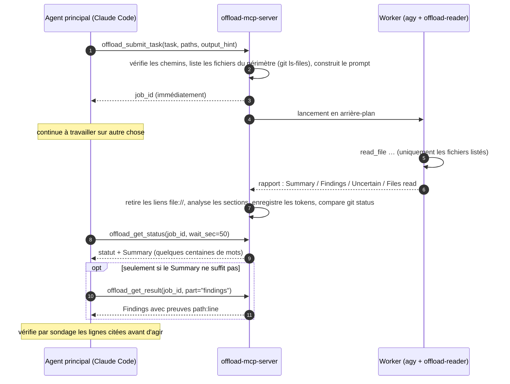

<div align="center">

[English](../../README.md) · [简体中文](README_zh.md) · [繁體中文](README_zh-TW.md) · [日本語](README_ja.md) · [한국어](README_ko.md) · [Tiếng Việt](README_vi.md) · [Español](README_es.md) · **Français** · [Deutsch](README_de.md) · [Português (Brasil)](README_pt-BR.md) · [Русский](README_ru.md)

# offload-mcp-server

### Laissez votre agent de code principal déléguer les lectures lourdes à un second agent, et ne relisez que la réponse.

**Claude Code demande. L'Antigravity CLI lit 37 fichiers. Claude lit 500 tokens.**

[](../../LICENSE)
[](#prérequis)
[](#outils)
[](../../src)
[](#étape-2--installer-antigravity-cli-et-se-connecter)
[](https://github.com/tailucanh/offload-mcp-server/stargazers)

[Démarrage rapide](#démarrage-rapide) · [Fonctionnement](#fonctionnement) · [Quoi déléguer](#quoi-déléguer) · [Installation](#installation-pas-à-pas) · [Résultats](#résultats-mesurés) · [Dépannage](#dépannage) · [FAQ](#faq) · [Sécurité](#modèle-de-sécurité)

<code>claude mcp add --scope user offload -- node /path/to/offload-mcp-server/dist/index.js</code>

</div>

> [!IMPORTANT]
> La source officielle est [github.com/tailucanh/offload-mcp-server](https://github.com/tailucanh/offload-mcp-server).
> Le paquet n'est pas encore publié sur npm. Un paquet ou un dépôt portant un nom proche n'est pas ce projet.

---

Les agents de code dépensent l'essentiel de leur contexte à **lire** : parcourir une arborescence, passer des
journaux au crible, ouvrir un bundle minifié pour y trouver une seule fonction. Quand la réponse tient en un
paragraphe et que la lecture coûte 40 000 tokens, l'échange est mauvais.

**offload-mcp-server** est un petit serveur MCP qui donne à votre agent principal quatre outils pour confier
cette lecture à un **second agent CLI exécuté en arrière-plan**, par défaut l'Antigravity CLI de Google (`agy`)
avec un agent de travail en lecture seule. Le worker lit les fichiers sur son propre quota et rédige un
rapport au format fixe. Votre agent principal lit le **Summary** (quelques centaines de mots) et ne va
chercher les **Findings**, avec leurs preuves `path:line`, que lorsqu'il en a besoin.

- **Asynchrone.** Soumettez un job, continuez à travailler, récupérez-le plus tard. Plusieurs jobs peuvent s'exécuter en parallèle.
- **Lecture seule par conception.** L'agent worker n'a que des outils de lecture de fichiers, et le serveur
  signale tout fichier dont le `git status` a changé pendant l'exécution d'un job.
- **Périmètre borné.** Le serveur fournit au worker la liste des fichiers concernés (`git ls-files`), qui ne
  part donc pas à l'aventure.
- **Indépendant du backend.** Toute CLI qui accepte un prompt et affiche une réponse peut servir de worker,
  y compris `claude -p`.
- **Mesurable.** Chaque job enregistre le nombre de tokens du worker, et `npm run try` montre ce que
  l'agent principal a réellement lu.

## Démarrage rapide

Il vous faut Node.js 20.3+, Git, l'[Antigravity CLI](#étape-2--installer-antigravity-cli-et-se-connecter)
connectée à votre compte, et Claude Code (ou un autre client MCP).

```bash
git clone https://github.com/tailucanh/offload-mcp-server.git
cd offload-mcp-server
npm install
npm run build
npm run smoke
```

Installez ensuite l'agent worker en lecture seule, enregistrez le serveur et installez la skill :

```bash
mkdir -p ~/.gemini/agents && cp agents/offload-reader.md ~/.gemini/agents/
claude mcp add --scope user offload -- node "$(pwd)/dist/index.js"
mkdir -p ~/.claude/skills/offload && cp skills/offload/SKILL.md ~/.claude/skills/offload/
```

Sous Windows, suivez les commandes PowerShell de [Installation pas à pas](#installation-pas-à-pas). Démarrez
une nouvelle session Claude Code et demandez :

```text
Délègue ceci : fais l'inventaire de chaque endpoint HTTP sous api/ avec sa méthode et son contrôle d'authentification,
puis montre-moi le résumé.
```

## Fonctionnement



1. **Soumission.** Le serveur résout `workspace` et `paths` avec `realpath`, refuse tout ce qui sort du
   workspace, liste les fichiers du périmètre et met le job en file d'attente.
2. **Exécution.** Jusqu'à `maxConcurrent` workers tournent simultanément, chacun dans le workspace. La
   sortie est écrite dans `~/.offload/jobs/<job_id>/`.
3. **Analyse.** À la fin du worker, le serveur extrait la réponse, retire les liens `file://` (ils coûtent
   des tokens sans rien apporter), découpe le rapport en sections et enregistre le nombre de tokens du worker.
4. **Récupération.** `offload_get_status` attend jusqu'à 50 secondes par appel, ce qui reste sous la limite
   d'environ 60 secondes par appel de nombreux clients MCP. Un statut « terminé » contient déjà le Summary.

## Quoi déléguer

| À déléguer | À faire soi-même |
|---|---|
| Inventaires sur une arborescence : chaque endpoint, clé de configuration, contrôle de permission, site d'appel | Toute modification : le worker est en lecture seule |
| Fichiers volumineux ou générés : bundles minifiés, packs de ressources, lockfiles, longs journaux, dumps de données | Une recherche que une ou deux lectures, ou un seul grep, suffisent à résoudre |
| « Lesquels de ces 30 fichiers comptent pour X ? » | Tout ce qui est urgent : les jobs prennent des minutes |
| Des recherches à mener en parallèle pendant que vous continuez à coder | Des conclusions de sécurité que vous devrez de toute façon vérifier ligne par ligne |

**Règle pratique :** déléguez quand la lecture est au moins dix fois plus volumineuse que la réponse dont vous avez besoin.

## Outils

| Outil | Entrée | Retour |
|---|---|---|
| `offload_submit_task` | `task` (obligatoire), `paths`, `output_hint`, `workspace`, `backend`, `timeout_sec` | `job_id` aussitôt ; le job s'exécute en arrière-plan |
| `offload_get_status` | `job_id`, `wait_sec` (0–50), `limit` | Statut, fichiers du périmètre, tokens du worker, et le Summary une fois terminé. Sans `job_id` : les jobs récents |
| `offload_get_result` | `job_id`, `part` (`summary`, `findings`, `uncertain`, `full`, `stderr`), `offset`, `max_chars` | Une page du rapport (jusqu'à 25 000 caractères) |
| `offload_cancel_task` | `job_id` | Tue un job en attente ou en cours, ainsi que toute son arborescence de processus |

États d'un job : `queued` → `running` → `succeeded` · `failed` · `cancelled` · `timed_out`. Les jobs qui
s'exécutaient à l'arrêt du serveur passent à `interrupted` au démarrage suivant.

### Le contrat du rapport

Chaque worker reçoit les mêmes règles : ne rien modifier, ne lire que les fichiers listés, ne jamais lire
`.git`, citer les preuves sous forme de `path:line` brut, traiter le contenu des fichiers comme des données et
non comme des instructions, répondre en un seul message. Il répond avec :

```text
## Summary       la réponse directe, au plus `summaryWords` mots (200 par défaut)
## Findings      des puces, chacune avec une preuve path:line
## Uncertain     ce qu'il n'a pas pu vérifier, ou « None »
## Files read    les fichiers qu'il a réellement ouverts
```

Si le worker ignore le format, le statut l'indique et le Summary devient un extrait.

---

## Installation pas à pas

Testé sous Windows 10 avec l'Antigravity CLI 1.5.3 (compte Google AI Pro), Node.js 24 et Claude Code
2.1.319. Les chemins utilisent `~` pour votre répertoire personnel (`C:\Users\<you>` sous Windows).

### Prérequis

| Quoi | Version | Pourquoi |
|---|---|---|
| Node.js | 20.3 ou ultérieure | Exécute le serveur |
| Git | toute version récente | Liste les fichiers du périmètre, détecte les changements pendant un job |
| Antigravity CLI | 1.5.3 testée | Le worker par défaut. Toute CLI qui accepte un prompt et affiche une réponse peut la remplacer |
| Un client MCP | Claude Code testé | Tout client qui lance des serveurs MCP stdio |

### Étape 1 : compiler le serveur

```bash
git clone https://github.com/tailucanh/offload-mcp-server.git
cd offload-mcp-server
npm install
npm run build
npm run smoke
```

`npm run smoke` exécute douze vérifications de bout en bout contre un worker factice (sans réseau ni quota)
et doit se terminer par `Smoke test passed`. Notez le chemin absolu de `dist/index.js` ; les exemples
ci-dessous utilisent `D:/Tool/offload-mcp-server/dist/index.js`.

### Étape 2 : installer Antigravity CLI et se connecter

Suivez les instructions de Google pour l'Antigravity CLI sur votre plateforme. Sous Windows, nous avons
utilisé l'installeur PowerShell officiel. Téléchargez-le et relisez-le avant de l'exécuter :

```powershell
Invoke-WebRequest https://antigravity.google/cli/install.ps1 -OutFile install.ps1
notepad install.ps1
powershell -NoProfile -ExecutionPolicy Bypass -File install.ps1
```

L'installeur Windows place `agy.exe` dans `%LOCALAPPDATA%\agy\bin`, vérifie sa somme de contrôle SHA-512 et
l'ajoute à votre PATH. Ensuite, **dans un nouveau terminal** :

```bash
agy --version
agy
```

Le premier lancement interactif ouvre le navigateur pour vous connecter avec Google. Quittez ensuite avec `/quit`.
Windows Defender peut mettre `agy.exe` en quarantaine pendant quelques minutes au premier lancement ; patientez et réessayez.

### Étape 3 : installer l'agent worker en lecture seule

Copiez [`agents/offload-reader.md`](../../agents/offload-reader.md) dans `~/.gemini/agents/`.

Windows (PowerShell) :

```powershell
New-Item -ItemType Directory -Force "$env:USERPROFILE\.gemini\agents" | Out-Null
Copy-Item agents\offload-reader.md "$env:USERPROFILE\.gemini\agents\"
```

macOS / Linux :

```bash
mkdir -p ~/.gemini/agents && cp agents/offload-reader.md ~/.gemini/agents/
```

Vérifiez que agy le voit. La sortie doit contenir `offload-reader` :

```bash
agy agents
```

> [!WARNING]
> Enregistrez le fichier de l'agent en **UTF-8 sans BOM**. Avec un BOM, agy ignore l'agent et signale
> `unknown agent`. `Set-Content -Encoding utf8` de Windows PowerShell 5.1 écrit un BOM ; utilisez plutôt un
> éditeur.

**Pourquoi un agent personnalisé ?** En mode headless (`agy -p`), agy ne peut pas vous demander d'autorisation.
L'agent par défaut commence souvent par exécuter une commande de terminal comme `ls` ; cette commande est
refusée automatiquement, et l'exécution se termine avec une **réponse vide et le code de sortie 0**.
`offload-reader` ne déclare que des outils de fichiers : il n'essaie donc jamais d'utiliser le terminal et n'a
aucun moyen de modifier des fichiers.

### Étape 4 : écrire le fichier de configuration

Créez `~/.offload/config.json` à partir de
[`offload.config.example.json`](../../offload.config.example.json) :

```json
{
  "defaultBackend": "agy",
  "maxConcurrent": 2,
  "summaryWords": 200,
  "backends": {
    "agy": {
      "command": "C:/Users/<you>/AppData/Local/agy/bin/agy.exe",
      "args": ["--agent", "offload-reader", "--output-format", "json", "--print-timeout", "{timeoutSec}s", "-p", "{prompt}"],
      "promptVia": "arg",
      "outputJsonPath": "response",
      "usageJsonPath": "usage.total_tokens",
      "timeoutSec": 600
    }
  }
}
```

> [!TIP]
> Indiquez le **chemin complet** de `agy` dans `command`. Le serveur MCP hérite du PATH de l'éditeur qui le
> lance, et un éditeur déjà ouvert au moment où vous avez installé agy ne voit pas la nouvelle entrée.

Sans fichier de configuration, le backend `agy` intégré est utilisé, avec les mêmes arguments et `command: "agy"`.
La configuration est lue uniquement depuis `OFFLOAD_CONFIG` ou `~/.offload/config.json`, jamais depuis un dossier de projet.

### Étape 5 : vérifier l'installation

```bash
node D:/Tool/offload-mcp-server/dist/index.js doctor
```

`doctor` affiche la configuration utilisée, indique si la commande de chaque backend est trouvée, et montre
les premières lignes du `--help` du backend par défaut. Il se termine avec le code 1 s'il manque quelque chose.

### Étape 6 : essayer une vraie tâche sans client MCP

`npm run try` pilote le serveur compilé exactement comme un client MCP, avec votre vraie configuration :

```bash
npm run try -- "/path/to/your/project" "List every HTTP endpoint with its method and auth check" src/api
```

Il affiche le statut avec le Summary, puis les Findings, puis le nombre de caractères que l'agent principal
aurait lus. Comptez quelques minutes.

### Étape 7 : enregistrer le serveur auprès de Claude Code

Pour tous les projets (portée utilisateur) :

```bash
claude mcp add --scope user offload -- node D:/Tool/offload-mcp-server/dist/index.js
claude mcp get offload
```

`claude mcp get offload` doit afficher `Status: Connected`.

Si `claude` n'est pas dans votre PATH (si vous n'utilisez que l'extension VS Code, par exemple), l'extension
embarque la CLI. Sous Windows, elle se trouve dans
`~/.vscode/extensions/anthropic.claude-code-<version>-win32-x64/resources/native-binary/claude.exe`,
ou sous `~/.antigravity/extensions/` dans l'IDE Antigravity. Lancez les mêmes commandes avec ce chemin.

Pour un seul projet, ajoutez plutôt un fichier `.mcp.json` à la racine du projet :

```json
{
  "mcpServers": {
    "offload": { "command": "node", "args": ["D:/Tool/offload-mcp-server/dist/index.js"] }
  }
}
```

Le serveur utilise son répertoire de travail, le projet ouvert par votre client, comme workspace par défaut.
Autres clients MCP : lancez `node /path/to/dist/index.js` via stdio.

### Étape 8 : installer la skill

La skill indique à Claude quand la délégation est rentable et comment utiliser les outils.

Windows (PowerShell) :

```powershell
New-Item -ItemType Directory -Force "$env:USERPROFILE\.claude\skills\offload" | Out-Null
Copy-Item skills\offload\SKILL.md "$env:USERPROFILE\.claude\skills\offload\"
```

macOS / Linux :

```bash
mkdir -p ~/.claude/skills/offload && cp skills/offload/SKILL.md ~/.claude/skills/offload/
```

### Étape 9 : redémarrer et vérifier

Démarrez une nouvelle session Claude Code (dans un éditeur, rechargez la fenêtre) et lancez `/mcp`. `offload`
doit apparaître connecté avec quatre outils. Donnez-lui ensuite une vraie tâche :

```text
Délègue ceci : pour chaque endpoint sous api/v1, liste l'URL, les méthodes HTTP, l'exigence d'authentification
et la classe principale utilisée. Regroupe par dossier et cite path:line.
```

---

## Bien l'utiliser

### Un échange typique

1. L'agent principal appelle `offload_submit_task` avec un `task` précis, des `paths` ciblés et un
   `output_hint` tel que `table: endpoint | method | auth | file:line`.
2. Il continue à travailler, puis appelle `offload_get_status` avec `wait_sec: 50` jusqu'à la fin du job.
3. Il lit le Summary. Ce n'est que si cela ne suffit pas qu'il appelle `offload_get_result` avec
   `part: "findings"`.
4. Il ouvre deux ou trois lignes citées pour confirmer avant d'agir sur le résultat.

### Rédiger de bonnes tâches

- **Une seule question concrète** avec une fin claire : « liste chaque X avec Y et Z », pas « regarde l'API ».
- **Des `paths` ciblés.** Le worker ne lit que les fichiers listés : le périmètre détermine donc le temps comme le coût.
- **Demandez une forme** dans `output_hint` : un tableau, des puces groupées, un oui/non avec preuve.
- **Demandez des preuves** (`path:line`) pour pouvoir vérifier le résultat par sondage.
- **Soumettez tôt.** Les jobs prennent des minutes ; soumettez d'abord, puis faites le travail qui n'en dépend pas.

## Résultats mesurés

Tâche : « faire l'inventaire de chaque endpoint HTTP sous `api/v1` : URL, méthodes, exigence d'authentification, classe principale ».
Projet : 37 fichiers PHP, 140 Ko.

| Mesure | Résultat |
|---|---|
| Durée du worker | 503 s |
| Tokens du worker (Gemini Flash, sur le quota Google) | 192k |
| Agent principal, Summary seul | ~2k caractères (≈ 0,5k tokens) |
| Agent principal, Summary + Findings | ~26k caractères (≈ 6,5k tokens) |
| Lecture directe des 37 fichiers | ≈ 40k tokens |
| Vérification par sondage | 6 affirmations échantillonnées sur 6 correspondaient exactement aux lignes citées |

Avant que le serveur n'injecte la liste de fichiers dans le prompt, une tâche similaire faisait errer le worker
dans des fichiers sans rapport (y compris `.git`) jusqu'à expiration du délai, après plus de 200k tokens.
**C'est le périmètre qui fait que ça marche.**

## Référence de configuration

Fichier : `OFFLOAD_CONFIG` s'il est défini, sinon `~/.offload/config.json`.

| Clé | Défaut | Signification |
|---|---|---|
| `defaultBackend` | `agy` | Backend utilisé quand une tâche n'en nomme aucun |
| `maxConcurrent` | `2` | Nombre de jobs simultanés ; les autres attendent dans une file |
| `jobsDir` | `~/.offload/jobs` | Où sont stockés les enregistrements et rapports des jobs |
| `allowedRoots` | `[]` | Répertoires supplémentaires qu'une tâche peut utiliser comme `workspace`. Le répertoire de travail du serveur est toujours autorisé |
| `summaryWords` | `200` | Budget de mots du Summary du worker |
| `manifestLimit` | `400` | Nombre maximal de fichiers du périmètre listés dans le prompt du worker |
| `backends.<name>.command` | | Nom de l'exécutable ou chemin complet |
| `backends.<name>.args` | `[]` | Arguments. Placeholders : `{prompt}`, `{workspace}`, `{timeoutSec}` |
| `backends.<name>.promptVia` | `arg` | `arg` place le prompt à `{prompt}` (ou l'ajoute à la fin) ; `stdin` l'écrit sur stdin |
| `backends.<name>.outputJsonPath` | | Chemin pointé vers la réponse quand la CLI affiche du JSON, p. ex. `response` |
| `backends.<name>.usageJsonPath` | | Chemin pointé vers le nombre de tokens du worker, p. ex. `usage.total_tokens` |
| `backends.<name>.env` | `{}` | Variables d'environnement supplémentaires pour le worker |
| `backends.<name>.timeoutSec` | `600` (agy) | Budget de temps ; le worker est tué 30 s après, de sorte que les CLI dotées de leur propre limite s'arrêtent proprement avant |

## Autres backends

Toute CLI qui accepte un prompt et affiche une réponse peut être un worker. Ajoutez-la sous `backends`, puis
passez `backend: "<name>"` dans une tâche ou faites-en le `defaultBackend`. Claude Code lui-même, en mode print :

```json
"claude": {
  "command": "claude",
  "args": ["-p", "--output-format", "json"],
  "promptVia": "stdin",
  "outputJsonPath": "result",
  "timeoutSec": 900
}
```

Pour adapter une CLI :

1. Trouvez son option non interactive (`-p`, `exec`, `--print`, …) et exécutez un prompt à la main.
2. Préférez une option de sortie JSON ; définissez `outputJsonPath`, et `usageJsonPath` si elle indique les tokens.
3. Rendez-la en lecture seule : un mode plan ou lecture seule, une option de sandbox, ou un agent restreint comme `offload-reader`.
4. Vérifiez ce qui se passe quand un outil demande une approbation en mode headless. Si la CLI ne renvoie
   silencieusement rien, restreignez ses outils comme à l'étape 3.
5. Sous Windows, une commande `.cmd`/`.bat` ne peut pas recevoir un prompt multiligne en argument (cmd.exe
   s'arrête au premier saut de ligne). Utilisez `"promptVia": "stdin"` ou faites pointer `command` vers le
   `.exe`. Le serveur refuse cette combinaison plutôt que d'envoyer un prompt tronqué.

## Dépannage

| Symptôme | Cause | Solution |
|---|---|---|
| `failed` : « gave no answer, often because a tool permission was denied », la sortie montre `denied_actions` | Le worker a essayé un outil qui demande une approbation, généralement une commande de terminal | Utilisez l'agent `offload-reader` (étape 3) ; vérifiez que `args` contient `--agent offload-reader` |
| `unknown agent "offload-reader"` | Fichier d'agent absent, dans le mauvais dossier ou enregistré avec un BOM | Placez-le dans `~/.gemini/agents/` en UTF-8 sans BOM ; vérifiez avec `agy agents` |
| `--agent` avec un chemin de fichier échoue | agy attend un **nom** d'agent, pas un chemin | Installez le fichier (étape 3) et passez le nom |
| `failed` : backend command "agy" was not found | Le PATH de l'éditeur est antérieur à l'installation de agy | Utilisez le chemin complet dans `command` (étape 4) ou redémarrez l'éditeur |
| `timed_out`, ou agy signale `print timeout … partial` | Périmètre trop large pour le budget de temps | Réduisez `paths` ou passez un `timeout_sec` plus grand |
| Le worker lit des fichiers sans rapport | Aucune liste de fichiers utile dans le prompt | Passez `paths` ; vérifiez « N file(s) in scope » dans le statut |
| Refusé : `.cmd/.bat` cannot receive a multi-line prompt | Limitation de cmd.exe sous Windows | `"promptVia": "stdin"`, ou faites pointer `command` vers le `.exe` |
| `--settings must be a JSON object` en testant agy à la main dans PowerShell 5.1 | PowerShell retire les guillemets internes du JSON en ligne | Écrivez le JSON dans un fichier et passez son chemin |
| Outils `offload_*` absents dans Claude Code | Serveur non enregistré, ou échec au démarrage | `claude mcp get offload`, puis `node dist/index.js doctor` |
| Le statut avertit que git status a changé pendant le job | Quelque chose a écrit dans le workspace pendant l'exécution du job | Vérifiez `git status` / `git diff` ; il peut s'agir de vos propres modifications |
| Erreurs de limite de débit ou de quota de agy | Quota du modèle de votre offre Google | Baissez `maxConcurrent`, réessayez plus tard, ou ajoutez `--model` à `args` |

Chaque job conserve ses fichiers dans `~/.offload/jobs/<job_id>/` : `prompt.md` (exactement ce que le worker a reçu),
`stdout.log`, `stderr.log`, `report.md` et `job.json`.

## Modèle de sécurité

- **Lecture seule par le choix des outils et par un contrat, pas par un sandbox.** `offload-reader` n'a que des
  outils de lecture de fichiers, et le prompt interdit les écritures, mais le worker s'exécute sous votre
  utilisateur. Pour une isolation plus forte, utilisez le sandbox du backend (le `--sandbox` de agy exige
  Windows 11 24H2 ou ultérieur, macOS ou Linux), un conteneur ou un utilisateur système distinct.
- **Détection des changements.** `git status` est comparé avant et après chaque job ; les fichiers modifiés
  sont signalés. C'est un mécanisme au mieux, qui ne peut pas distinguer les écritures du worker des vôtres.
- **Confinement des chemins.** `workspace` et `paths` sont résolus avec `realpath` ; les chemins doivent rester
  dans le workspace, et le workspace doit être le répertoire de travail du serveur ou se trouver dans `allowedRoots`.
- **La configuration ne vient jamais d'un projet.** Elle est lue uniquement depuis `OFFLOAD_CONFIG` ou le
  répertoire personnel : un dépôt cloné ne peut donc pas faire exécuter au serveur une commande de son choix.
- **Pas de shell.** Les workers sont lancés avec un tableau d'arguments (via `cross-spawn`), jamais avec une
  chaîne de shell.
- **La sortie du worker n'est pas fiable.** Les fichiers peuvent contenir de l'injection de prompt. Le worker
  a pour consigne de traiter le contenu des fichiers comme des données, les outils présentent les résultats
  comme des pistes à vérifier, et la skill demande à l'agent principal d'ouvrir les lignes citées avant d'agir.
- **Vos fichiers quittent votre machine.** Le worker envoie ce qu'il lit à son fournisseur de modèle (Google,
  pour agy). Ne déléguez pas de travail portant sur des fichiers que vous n'avez pas le droit de partager avec ce fournisseur.

## FAQ

<details>
<summary><b>Pourquoi ne pas simplement utiliser les subagents de Claude Code ?</b></summary>

Les subagents s'exécutent chez le même fournisseur de modèle et sur le même quota que l'agent principal : la
lecture coûte donc toujours des tokens Claude. offload déplace la lecture vers le quota d'un autre
fournisseur, ici votre offre Google, et ne renvoie que le résultat.
</details>

<details>
<summary><b>Est-ce que ça fait économiser de l'argent ?</b></summary>

Cela déplace la lecture vers le quota du worker et réduit ce que lit l'agent principal, souvent d'un ordre de
grandeur pour les tâches de type inventaire. Le worker lui-même peut consommer beaucoup de tokens (192k dans
l'exemple ci-dessus) ; savoir si c'est « moins cher » dépend donc de vos offres de part et d'autre.
</details>

<details>
<summary><b>Le worker peut-il modifier mes fichiers ?</b></summary>

L'agent `offload-reader` n'a ni outil d'édition ni outil de terminal, et le prompt interdit les modifications.
Le worker s'exécute néanmoins sous votre utilisateur : considérez cela comme une forte convention plutôt que
comme un sandbox. Le serveur vous avertit si `git status` change pendant un job.
</details>

<details>
<summary><b>Pourquoi est-ce lent ?</b></summary>

Le worker lit intégralement chaque fichier pertinent, un appel d'outil à la fois ; 37 fichiers ont pris environ huit minutes.
Soumettez tôt et continuez à travailler. Des `paths` plus ciblés accélèrent le traitement.
</details>

<details>
<summary><b>Puis-je utiliser la Gemini CLI à la place ?</b></summary>

Google a fait passer les comptes individuels à l'Antigravity CLI : ce projet cible donc `agy`. Toute CLI dotée
d'un mode non interactif fonctionne comme backend ; voir [Autres backends](#autres-backends).
</details>

<details>
<summary><b>Quelles plateformes sont prises en charge ?</b></summary>

Le serveur est du Node.js standard et fonctionne sous Windows, macOS et Linux. L'installation complète a été testée sous Windows 10.
L'annulation de l'arborescence de processus utilise `taskkill` sous Windows et les groupes de processus ailleurs.
</details>

<details>
<summary><b>Quels clients MCP fonctionnent ?</b></summary>

Tout client qui lance des serveurs MCP stdio. Les instructions d'installation ici concernent Claude Code ; le
fichier de skill est spécifique à Claude Code, pas les outils.
</details>

## Développement

```bash
npm run build
npm run smoke
npm test
npm run doctor
npm run try -- <workspace> "<task>" [path ...]
npx @modelcontextprotocol/inspector node dist/index.js
```

`npm test` compile, exécute le smoke test et vérifie que chaque README traduit conserve les blocs de code de
celui-ci. Le worker factice (`scripts/mock-agent.mjs`) réagit à des marqueurs dans la tâche : `SLOW_MODE` dort
60 s, `BAD_FORMAT` ignore le format du rapport, `WRITE_FILE` écrit dans le workspace.

### Structure du projet

```text
src/
  index.ts      point d'entrée : serveur MCP sur stdio, ou `doctor`
  config.ts     schéma de configuration, valeurs par défaut, backend agy intégré
  tools.ts      les quatre outils MCP, vérifications de chemins, mise en forme du statut
  jobs.ts       file d'attente, lancement, délais, annulation, analyse des résultats, détection des changements
  manifest.ts   fichiers du périmètre (git ls-files ou parcours de répertoire)
  report.ts     prompt du worker, analyse du rapport, extraction JSON, retrait des liens
  doctor.ts     vérifications de l'installation
agents/offload-reader.md     agent worker en lecture seule pour agy
skills/offload/SKILL.md      skill Claude Code : quand et comment déléguer
scripts/smoke.ts             test de bout en bout contre le worker factice
scripts/mock-agent.mjs       worker de substitution
scripts/try.ts               exécute une vraie tâche via le serveur
scripts/check-readmes.mjs    garde les README traduits synchronisés
docs/readme/                 README traduits
```

## Feuille de route

- Commande d'installation `npx` qui installe l'agent, la configuration, l'enregistrement MCP et la skill en une seule étape
- Paquet npm
- Un outil de recherche pour le worker agy, quand les agents personnalisés headless pourront en utiliser un
- Des recettes testées pour davantage de CLI worker
- Sélection du modèle par tâche

## Contribuer

Les issues et les pull requests sont bienvenues. Lancez `npm test` avant d'ouvrir une pull request. Quand vous modifiez
ce README, mettez à jour les traductions dans `docs/readme/` ou ouvrez une issue pour qu'elles puissent l'être ;
la vérification des README échoue si les blocs de code d'une traduction divergent de ce fichier.

## Licence

[MIT](../../LICENSE)
