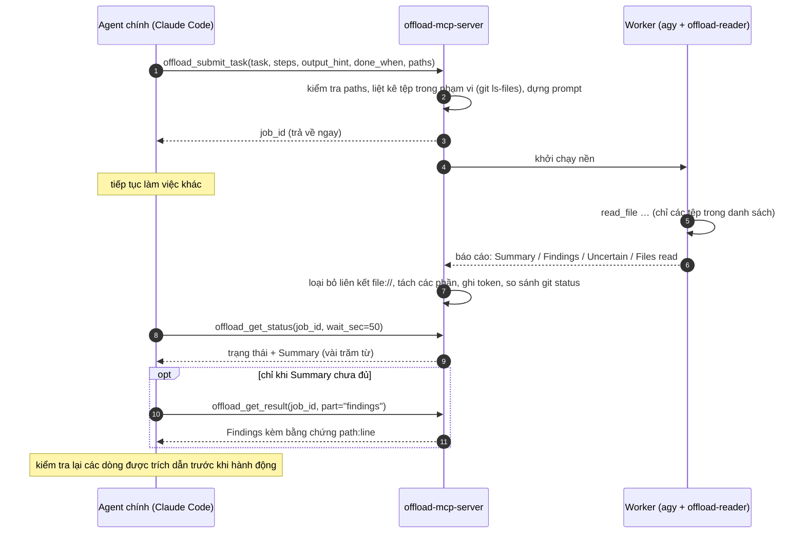

<div align="center">

[English](../../README.md) · [简体中文](README_zh.md) · [繁體中文](README_zh-TW.md) · [日本語](README_ja.md) · [한국어](README_ko.md) · **Tiếng Việt** · [Español](README_es.md) · [Français](README_fr.md) · [Deutsch](README_de.md) · [Português (Brasil)](README_pt-BR.md) · [Русский](README_ru.md)

# offload-mcp-server

### Để agent lập trình chính giao phần đọc nặng cho một agent thứ hai, và chỉ đọc lại câu trả lời.

**Claude Code đặt câu hỏi. Antigravity CLI đọc 37 tệp. Claude chỉ đọc 500 token.**

[](https://www.npmjs.com/package/offload-mcp-server)
[](../../LICENSE)
[](#yêu-cầu)
[](#công-cụ)
[](../../src)
[](#bước-2-cài-đặt-và-đăng-nhập-antigravity-cli)
[](https://github.com/tailucanh/offload-mcp-server/stargazers)

[Bắt đầu nhanh](#bắt-đầu-nhanh) · [Cách hoạt động](#cách-hoạt-động) · [Nên giao việc gì](#nên-giao-việc-gì) · [Cài đặt](#cài-đặt-từng-bước) · [Kết quả đo được](#kết-quả-đo-được) · [Xử lý sự cố](#xử-lý-sự-cố) · [FAQ](#faq) · [Bảo mật](#mô-hình-bảo-mật)

<code>npx -y offload-mcp-server setup</code>


</div>

> [!IMPORTANT]
> Nguồn chính thức là [github.com/tailucanh/offload-mcp-server](https://github.com/tailucanh/offload-mcp-server).
> Gói npm là [`offload-mcp-server`](https://www.npmjs.com/package/offload-mcp-server). Gói hoặc repository có tên gần giống không phải dự án này.

---

Phần lớn context của các agent lập trình bị tiêu vào việc **đọc**: duyệt cây mã nguồn, quét log, mở một
bundle đã minify để tìm một hàm. Khi câu trả lời chỉ dài một đoạn mà việc đọc tốn 40.000 token, đó là
một cuộc đổi chác không có lợi.

**offload-mcp-server** là một MCP server nhỏ, cung cấp cho agent chính bốn công cụ để giao việc đọc đó
cho **một agent CLI thứ hai chạy nền**, mặc định là Antigravity CLI (`agy`) của Google với một agent
worker chỉ đọc. Worker đọc tệp bằng hạn mức của riêng nó và ghi ra một báo cáo theo định dạng cố định.
Agent chính chỉ đọc phần **Summary** (vài trăm từ), và chỉ lấy phần **Findings** kèm bằng chứng
`path:line` khi thật sự cần.

- **Bất đồng bộ.** Gửi tác vụ, tiếp tục làm việc khác, lấy kết quả sau. Có thể chạy song song nhiều tác vụ.
- **Chỉ đọc theo thiết kế.** Agent worker chỉ có công cụ đọc tệp, và server báo cáo mọi tệp có
  `git status` thay đổi trong lúc tác vụ chạy.
- **Có phạm vi rõ ràng.** Server liệt kê các tệp thuộc phạm vi (`git ls-files`) cho worker, nên worker
  không đi lạc.
- **Không phụ thuộc backend.** Mọi CLI nhận một prompt và in ra câu trả lời đều có thể làm worker, kể cả
  `claude -p`.
- **Đo lường được.** Mỗi tác vụ ghi lại số token của worker, và `npm run try` cho thấy agent chính thực
  sự đã đọc bao nhiêu.

## Bắt đầu nhanh

Bạn cần Node.js 20.3+, [Antigravity CLI](#bước-2-cài-đặt-và-đăng-nhập-antigravity-cli) đã cài và đăng nhập, và Claude Code (hoặc MCP client khác). Sau đó chạy:

```bash
npx -y offload-mcp-server setup
```

`setup` tìm Antigravity CLI, cài agent worker chỉ đọc (`~/.gemini/agents/`) và skill cho Claude Code (`~/.claude/skills/offload/`), tạo `~/.offload/config.json` nếu chưa có, rồi đăng ký server với Claude Code. Chạy lại sau khi cập nhật vẫn an toàn: file nào đã bị sửa sẽ được lưu thành `.bak` trước. Thêm `--dry-run` để xem trước nó sẽ làm gì.

Mở phiên Claude Code mới (hoặc reload cửa sổ editor) và hỏi:

```text
Hãy offload việc này: liệt kê mọi HTTP endpoint trong api/ cùng method và phần kiểm tra xác thực,
rồi cho tôi xem phần tóm tắt.
```

Nếu muốn chạy từ bản clone, để phát triển:

```bash
git clone https://github.com/tailucanh/offload-mcp-server.git
cd offload-mcp-server
npm install
npm run build
node dist/index.js setup
```

[Cài đặt từng bước](#cài-đặt-từng-bước) giải thích từng phần và cách làm thủ công.

## Cách hoạt động



1. **Gửi.** Server phân giải `workspace` và `paths` bằng `realpath`, từ chối mọi thứ nằm ngoài
   workspace, liệt kê các tệp thuộc phạm vi rồi đưa tác vụ vào hàng đợi.
2. **Chạy.** Tối đa `maxConcurrent` worker chạy cùng lúc, mỗi worker chạy trong workspace. Đầu ra được
   ghi vào `~/.offload/jobs/<job_id>/`.
3. **Phân tích.** Khi worker kết thúc, server trích câu trả lời, loại bỏ liên kết `file://` (chúng tốn
   token mà không có thêm giá trị), tách báo cáo thành các phần và ghi lại số token của worker.
4. **Thu kết quả.** `offload_get_status` chờ tối đa 50 giây mỗi lần gọi, thấp hơn giới hạn khoảng
   60 giây mỗi lần gọi của nhiều MCP client. Trạng thái "đã hoàn thành" đã kèm sẵn Summary.

## Nên giao việc gì

| Nên offload | Nên tự làm |
|---|---|
| Thống kê trên cả cây thư mục: mọi endpoint, config key, bước kiểm tra quyền, vị trí gọi hàm | Mọi loại chỉnh sửa: worker chỉ có quyền đọc |
| Tệp lớn hoặc được sinh tự động: bundle đã minify, gói tài nguyên, lockfile, log dài, bản dump dữ liệu | Việc tra cứu chỉ cần một hai lần đọc, hoặc một lệnh grep |
| "Trong 30 tệp này, tệp nào liên quan đến X?" | Việc gấp: tác vụ mất vài phút |
| Nghiên cứu có thể chạy song song trong khi bạn tiếp tục viết code | Kết luận về bảo mật mà dù sao bạn cũng phải kiểm chứng từng dòng |

**Nguyên tắc chung:** hãy offload khi lượng cần đọc lớn gấp ít nhất mười lần câu trả lời bạn cần.

## Công cụ

| Công cụ | Đầu vào | Trả về |
|---|---|---|
| `offload_submit_task` | `task`, `steps`, `output_hint`, `done_when` (cả bốn bắt buộc); `context`, `exclude`, `paths`, `workspace`, `backend`, `timeout_sec` | `job_id` ngay lập tức; tác vụ chạy nền |
| `offload_get_status` | `job_id`, `wait_sec` (0–50), `limit` | Trạng thái, các tệp trong phạm vi, token của worker, và Summary khi đã xong. Không có `job_id`: các tác vụ gần đây |
| `offload_get_result` | `job_id`, `part` (`summary`, `findings`, `steps`, `uncertain`, `full`, `stderr`), `offset`, `max_chars` | Một trang của báo cáo (tối đa 25.000 ký tự) |
| `offload_cancel_task` | `job_id` | Dừng một tác vụ đang chờ hoặc đang chạy cùng toàn bộ cây tiến trình của nó |

Các trạng thái của tác vụ: `queued` → `running` → `succeeded` · `failed` · `cancelled` · `timed_out`. Những
tác vụ đang chạy khi server dừng sẽ chuyển thành `interrupted` ở lần khởi động tiếp theo.

### Định dạng báo cáo

Mọi worker đều nhận cùng một bộ quy tắc: không sửa bất cứ thứ gì, chỉ đọc các tệp trong danh sách,
không bao giờ đọc `.git`, trích dẫn bằng chứng dưới dạng `path:line` thuần túy, coi nội dung tệp là dữ
liệu chứ không phải chỉ dẫn, và trả lời trong một thông điệp duy nhất. Worker phản hồi theo mẫu:

```text
## Summary       câu trả lời trực tiếp, tối đa `summaryWords` từ (mặc định 200)
## Findings      các gạch đầu dòng, mỗi dòng kèm bằng chứng path:line
## Step log      mỗi bước một dòng: done, partial hoặc not done
## Uncertain     những gì không kiểm chứng được, hoặc "None"
## Files read    các tệp thực sự đã mở
```

Nếu worker bỏ qua định dạng này, trạng thái sẽ ghi rõ và Summary sẽ trở thành một đoạn trích.

---

## Cài đặt từng bước

Đã thử nghiệm trên Windows 10 với Antigravity CLI 1.5.3 (tài khoản Google AI Pro), Node.js 24 và Claude
Code 2.1.319. Đường dẫn dùng `~` cho thư mục home của bạn (`C:\Users\<you>` trên Windows).

> [!TIP]
> `npx -y offload-mcp-server setup` làm sẵn các bước 3, 4, 7 và 8. Các bước dưới đây cho thấy nó làm gì và cách làm thủ công.

### Yêu cầu

| Thành phần | Phiên bản | Để làm gì |
|---|---|---|
| Node.js | 20.3 trở lên | Chạy server |
| Git | bản nào gần đây cũng được | Liệt kê tệp trong phạm vi, phát hiện thay đổi trong lúc tác vụ chạy |
| Antigravity CLI | đã thử với 1.5.3 | Worker mặc định. Mọi CLI nhận prompt và in ra câu trả lời đều có thể thay thế |
| Một MCP client | đã thử với Claude Code | Bất kỳ client nào khởi chạy được MCP server qua stdio |

### Bước 1: Build server

```bash
git clone https://github.com/tailucanh/offload-mcp-server.git
cd offload-mcp-server
npm install
npm run build
npm run smoke
```

`npm run smoke` chạy mười hai kiểm tra đầu-cuối với một worker giả lập (không dùng mạng, không tốn hạn
mức) và phải kết thúc bằng `Smoke test passed`. Hãy ghi lại đường dẫn tuyệt đối của `dist/index.js`; các
ví dụ bên dưới dùng `D:/Tool/offload-mcp-server/dist/index.js`.

### Bước 2: Cài đặt và đăng nhập Antigravity CLI

Làm theo hướng dẫn Antigravity CLI của Google cho nền tảng của bạn. Trên Windows, chúng tôi dùng trình
cài đặt PowerShell chính thức. Hãy tải về và đọc nội dung trước khi chạy:

```powershell
Invoke-WebRequest https://antigravity.google/cli/install.ps1 -OutFile install.ps1
notepad install.ps1
powershell -NoProfile -ExecutionPolicy Bypass -File install.ps1
```

Trình cài đặt trên Windows đặt `agy.exe` vào `%LOCALAPPDATA%\agy\bin`, xác minh checksum SHA-512 của
nó và thêm nó vào PATH. Sau đó, **trong một terminal mới**:

```bash
agy --version
agy
```

Lần chạy tương tác đầu tiên sẽ mở trình duyệt để đăng nhập bằng Google. Sau đó thoát bằng `/quit`.
Windows Defender có thể cách ly `agy.exe` vài phút ở lần khởi chạy đầu tiên; hãy đợi rồi thử lại.

### Bước 3: Cài agent worker chỉ đọc

Sao chép [`agents/offload-reader.md`](../../agents/offload-reader.md) vào `~/.gemini/agents/`.

Windows (PowerShell):

```powershell
New-Item -ItemType Directory -Force "$env:USERPROFILE\.gemini\agents" | Out-Null
Copy-Item agents\offload-reader.md "$env:USERPROFILE\.gemini\agents\"
```

macOS / Linux:

```bash
mkdir -p ~/.gemini/agents && cp agents/offload-reader.md ~/.gemini/agents/
```

Kiểm tra agy đã nhận ra nó chưa. Đầu ra phải chứa `offload-reader`:

```bash
agy agents
```

> [!WARNING]
> Hãy lưu tệp agent ở dạng **UTF-8 không có BOM**. Nếu có BOM, agy sẽ bỏ qua agent và báo
> `unknown agent`. Lệnh `Set-Content -Encoding utf8` của Windows PowerShell 5.1 ghi thêm BOM; hãy dùng
> trình soạn thảo thay thế.

**Tại sao cần một agent tùy chỉnh?** Ở chế độ headless (`agy -p`), agy không thể hỏi bạn xin quyền.
Agent mặc định thường chạy một lệnh terminal như `ls` trước tiên; lệnh đó bị từ chối tự động, và lần
chạy kết thúc với **câu trả lời rỗng và exit code 0**. `offload-reader` chỉ khai báo các công cụ tệp,
nên nó không bao giờ gọi đến terminal và không có cách nào để sửa tệp.

### Bước 4: Viết tệp cấu hình

Tạo `~/.offload/config.json`, bắt đầu từ
[`offload.config.example.json`](../../offload.config.example.json):

```json
{
  "defaultBackend": "agy",
  "maxConcurrent": 2,
  "summaryWords": 200,
  "backends": {
    "agy": {
      "command": "C:/Users/<you>/AppData/Local/agy/bin/agy.exe",
      "args": ["--agent", "offload-reader", "--output-format", "json", "--print-timeout", "{timeoutSec}s", "-p", "{prompt}"],
      "promptVia": "arg",
      "outputJsonPath": "response",
      "usageJsonPath": "usage.total_tokens",
      "timeoutSec": 600
    }
  }
}
```

> [!TIP]
> Hãy ghi **đường dẫn đầy đủ** tới `agy` trong `command`. MCP server kế thừa PATH của trình soạn thảo
> khởi chạy nó, và một trình soạn thảo đã mở sẵn từ trước khi bạn cài agy sẽ không thấy mục PATH mới.

Nếu không có tệp cấu hình, backend `agy` có sẵn sẽ được dùng, với cùng các tham số và `command: "agy"`.
Cấu hình chỉ được đọc từ `OFFLOAD_CONFIG` hoặc `~/.offload/config.json`, không bao giờ từ thư mục dự án.

### Bước 5: Kiểm tra cài đặt

```bash
node D:/Tool/offload-mcp-server/dist/index.js doctor
```

`doctor` in ra cấu hình đang dùng, cho biết lệnh của từng backend có được tìm thấy không, và vài dòng
đầu của `--help` của backend mặc định. Lệnh thoát với mã 1 nếu thiếu thứ gì đó.

### Bước 6: Chạy thử một tác vụ thật mà không cần MCP client

`npm run try` điều khiển server đã build y như một MCP client, với cấu hình thật của bạn:

```bash
npm run try -- "/path/to/your/project" "List every HTTP endpoint with its method and auth check" src/api
```

Lệnh in ra trạng thái kèm Summary, rồi đến Findings, rồi số ký tự mà agent chính sẽ phải đọc. Dự kiến
mất vài phút.

### Bước 7: Đăng ký server với Claude Code

Cho mọi dự án (phạm vi user):

```bash
claude mcp add --scope user offload -- node D:/Tool/offload-mcp-server/dist/index.js
claude mcp get offload
```

`claude mcp get offload` phải báo `Status: Connected`.

Nếu `claude` không nằm trong PATH (ví dụ bạn chỉ dùng tiện ích mở rộng VS Code), thì tiện ích mở rộng
đã đi kèm CLI. Trên Windows, nó nằm ở
`~/.vscode/extensions/anthropic.claude-code-<version>-win32-x64/resources/native-binary/claude.exe`,
hoặc trong `~/.antigravity/extensions/` nếu dùng Antigravity IDE. Hãy chạy các lệnh tương tự với đường
dẫn đó.

Nếu chỉ muốn dùng cho một dự án, hãy thêm `.mcp.json` ở thư mục gốc của dự án:

```json
{
  "mcpServers": {
    "offload": { "command": "node", "args": ["D:/Tool/offload-mcp-server/dist/index.js"] }
  }
}
```

Server lấy thư mục làm việc của nó, tức dự án mà client của bạn đang mở, làm workspace mặc định.
Với các MCP client khác: khởi chạy `node /path/to/dist/index.js` qua stdio.

### Bước 8: Cài skill

Skill cho Claude biết khi nào nên offload và cách dùng các công cụ.

Windows (PowerShell):

```powershell
New-Item -ItemType Directory -Force "$env:USERPROFILE\.claude\skills\offload" | Out-Null
Copy-Item skills\offload\SKILL.md "$env:USERPROFILE\.claude\skills\offload\"
```

macOS / Linux:

```bash
mkdir -p ~/.claude/skills/offload && cp skills/offload/SKILL.md ~/.claude/skills/offload/
```

### Bước 9: Khởi động lại và kiểm tra

Mở một phiên Claude Code mới (trong trình soạn thảo thì tải lại cửa sổ) và chạy `/mcp`. `offload` phải
ở trạng thái đã kết nối với bốn công cụ. Sau đó giao cho nó một tác vụ thật:

```text
Hãy offload việc này: với mỗi endpoint trong api/v1, liệt kê URL, các HTTP method, yêu cầu xác thực
và class chính được dùng. Nhóm theo thư mục và trích dẫn path:line.
```

---

## Dùng hiệu quả

### Một lượt trao đổi điển hình

1. Agent chính gọi `offload_submit_task` với `task` chính xác, `paths` hẹp, và một `output_hint` chẳng
   hạn như `table: endpoint | method | auth | file:line`.
2. Nó tiếp tục làm việc, rồi gọi `offload_get_status` với `wait_sec: 50` cho đến khi tác vụ hoàn thành.
3. Nó đọc Summary. Chỉ khi chưa đủ, nó mới gọi `offload_get_result` với `part: "findings"`.
4. Nó mở hai ba dòng được trích dẫn để xác nhận trước khi hành động dựa trên kết quả.

### Viết tác vụ hiệu quả

- **Một câu hỏi cụ thể** có điểm kết thúc rõ ràng: "liệt kê mọi X kèm Y và Z", chứ không phải "xem qua
  API".
- **`paths` hẹp.** Worker chỉ đọc các tệp trong danh sách, nên phạm vi quyết định cả thời gian lẫn chi
  phí.
- **Viết brief đầy đủ.** `steps` (các hành động cụ thể, theo thứ tự), `output_hint` và `done_when` là bắt buộc; `context` (những gì bạn đã biết) và `exclude` là tùy chọn. Worker làm đúng các bước đó và không làm gì thêm, ghi lại từng bước là done, partial hay not done, và trạng thái có một dòng *Brief check* nêu bước nào chưa xong.
- **Yêu cầu một dạng đầu ra** trong `output_hint`: bảng, danh sách nhóm theo mục, hoặc có/không kèm bằng
  chứng.
- **Yêu cầu bằng chứng** (`path:line`) để có thể kiểm tra chọn mẫu kết quả.
- **Gửi sớm.** Tác vụ mất vài phút; hãy gửi trước, rồi làm những việc không phụ thuộc vào chúng.

## Kết quả đo được

Tác vụ: "thống kê mọi HTTP endpoint trong `api/v1`: URL, các method, yêu cầu xác thực, class chính".
Dự án: 37 tệp PHP, 140 KB.

| Chỉ số | Kết quả |
|---|---|
| Thời gian của worker | 503 giây |
| Token của worker (Gemini Flash, tính vào hạn mức Google) | 192k |
| Agent chính, chỉ đọc Summary | ~2k ký tự (≈ 0,5k token) |
| Agent chính, đọc Summary + Findings | ~26k ký tự (≈ 6,5k token) |
| Đọc trực tiếp 37 tệp | ≈ 40k token |
| Kiểm tra chọn mẫu | 6/6 nhận định được kiểm tra khớp chính xác với các dòng được trích dẫn |

Trước khi server đưa danh sách tệp vào prompt, một tác vụ tương tự khiến worker đi lang thang qua các
tệp không liên quan (kể cả `.git`) và bị timeout sau hơn 200k token. **Phạm vi rõ ràng chính là yếu tố
làm nên hiệu quả.**

## Tham chiếu cấu hình

Tệp: `OFFLOAD_CONFIG` nếu được đặt, nếu không thì `~/.offload/config.json`.

| Khóa | Mặc định | Ý nghĩa |
|---|---|---|
| `defaultBackend` | `agy` | Backend được dùng khi tác vụ không chỉ định backend |
| `maxConcurrent` | `2` | Số tác vụ chạy cùng lúc; phần còn lại chờ trong hàng đợi |
| `jobsDir` | `~/.offload/jobs` | Nơi lưu hồ sơ tác vụ và báo cáo |
| `allowedRoots` | `[]` | Các thư mục bổ sung mà tác vụ được phép dùng làm `workspace`. Thư mục làm việc của server luôn được cho phép |
| `summaryWords` | `200` | Giới hạn số từ cho Summary của worker |
| `manifestLimit` | `400` | Số tệp trong phạm vi tối đa được liệt kê trong prompt của worker |
| `backends.<name>.command` | | Tên tệp thực thi hoặc đường dẫn đầy đủ |
| `backends.<name>.args` | `[]` | Các tham số. Placeholder: `{prompt}`, `{workspace}`, `{timeoutSec}` |
| `backends.<name>.promptVia` | `arg` | `arg` đặt prompt vào `{prompt}` (hoặc nối vào cuối); `stdin` ghi prompt vào stdin |
| `backends.<name>.outputJsonPath` | | Đường dẫn dạng dấu chấm tới câu trả lời khi CLI in ra JSON, ví dụ `response` |
| `backends.<name>.usageJsonPath` | | Đường dẫn dạng dấu chấm tới số token của worker, ví dụ `usage.total_tokens` |
| `backends.<name>.env` | `{}` | Biến môi trường bổ sung cho worker |
| `backends.<name>.timeoutSec` | `600` (agy) | Ngân sách thời gian; worker bị dừng cưỡng bức sau đó 30 giây, để các CLI có giới hạn riêng dừng êm trước |

## Các backend khác

Mọi CLI nhận một prompt và in ra câu trả lời đều có thể làm worker. Hãy thêm nó vào `backends`, rồi
truyền `backend: "<name>"` trong tác vụ hoặc đặt nó làm `defaultBackend`. Ví dụ với chính Claude Code ở
chế độ print:

```json
"claude": {
  "command": "claude",
  "args": ["-p", "--output-format", "json"],
  "promptVia": "stdin",
  "outputJsonPath": "result",
  "timeoutSec": 900
}
```

Khi điều chỉnh một CLI cho phù hợp:

1. Tìm cờ chạy không tương tác của nó (`-p`, `exec`, `--print`, …) và tự chạy thử một prompt.
2. Ưu tiên cờ xuất JSON; đặt `outputJsonPath`, và `usageJsonPath` nếu CLI báo cáo token.
3. Biến nó thành chỉ đọc: chế độ plan hoặc read-only, cờ sandbox, hoặc một agent bị giới hạn như `offload-reader`.
4. Kiểm tra điều gì xảy ra khi một công cụ cần được duyệt ở chế độ headless. Nếu CLI âm thầm trả về
   rỗng, hãy giới hạn công cụ của nó như ở Bước 3.
5. Trên Windows, lệnh `.cmd`/`.bat` không thể nhận prompt nhiều dòng làm tham số (cmd.exe dừng ở dòng
   mới đầu tiên). Hãy dùng `"promptVia": "stdin"` hoặc trỏ `command` tới tệp `.exe`. Server từ chối
   tổ hợp này thay vì gửi đi một prompt bị cắt cụt.

## Xử lý sự cố

| Triệu chứng | Nguyên nhân | Cách khắc phục |
|---|---|---|
| `failed`: "gave no answer, often because a tool permission was denied", đầu ra có `denied_actions` | Worker thử dùng một công cụ cần được duyệt, thường là lệnh terminal | Dùng agent `offload-reader` (Bước 3); kiểm tra `args` có chứa `--agent offload-reader` |
| `unknown agent "offload-reader"` | Thiếu tệp agent, đặt sai thư mục, hoặc lưu có BOM | Đặt nó vào `~/.gemini/agents/` ở dạng UTF-8 không BOM; kiểm tra bằng `agy agents` |
| `--agent` với đường dẫn tệp bị lỗi | agy nhận **tên** agent, không nhận đường dẫn | Cài tệp vào đúng chỗ (Bước 3) và truyền tên |
| `failed`: backend command "agy" was not found | PATH của trình soạn thảo có trước khi cài agy | Dùng đường dẫn đầy đủ trong `command` (Bước 4) hoặc khởi động lại trình soạn thảo |
| `timed_out`, hoặc agy báo `print timeout … partial` | Phạm vi quá lớn so với ngân sách thời gian | Thu hẹp `paths` hoặc truyền `timeout_sec` lớn hơn |
| Worker đọc các tệp không liên quan | Prompt không có danh sách tệp hữu ích | Truyền `paths`; kiểm tra "N file(s) in scope" trong trạng thái |
| Bị từ chối: `.cmd/.bat` cannot receive a multi-line prompt | Giới hạn của cmd.exe trên Windows | `"promptVia": "stdin"`, hoặc trỏ `command` tới tệp `.exe` |
| `--settings must be a JSON object` khi tự thử agy trong PowerShell 5.1 | PowerShell loại bỏ dấu nháy bên trong của JSON viết trực tiếp | Ghi JSON ra một tệp rồi truyền đường dẫn của tệp đó |
| Thiếu các công cụ `offload_*` trong Claude Code | Server chưa được đăng ký, hoặc khởi động thất bại | `claude mcp get offload`, rồi `node dist/index.js doctor` |
| Trạng thái cảnh báo git status đã thay đổi trong lúc chạy tác vụ | Có thứ gì đó ghi vào workspace khi tác vụ đang chạy | Kiểm tra `git status` / `git diff`; có thể là chính các chỉnh sửa của bạn |
| Lỗi rate-limit hoặc hạn mức từ agy | Hạn mức model của gói Google của bạn | Giảm `maxConcurrent`, thử lại sau, hoặc thêm `--model` vào `args` |

Mỗi tác vụ lưu các tệp của nó trong `~/.offload/jobs/<job_id>/`: `prompt.md` (đúng nguyên văn những gì
worker nhận được), `stdout.log`, `stderr.log`, `report.md` và `job.json`.

## Mô hình bảo mật

- **Chỉ đọc nhờ chọn công cụ và một hợp đồng, không phải sandbox.** `offload-reader` chỉ có công cụ đọc
  tệp, và prompt cấm ghi, nhưng worker chạy với quyền người dùng của bạn. Để cô lập mạnh hơn, hãy dùng
  sandbox của backend (`--sandbox` của agy cần Windows 11 24H2 trở lên, macOS hoặc Linux), một container,
  hoặc một người dùng hệ điều hành riêng.
- **Phát hiện thay đổi.** `git status` được so sánh trước và sau mỗi tác vụ; các tệp thay đổi sẽ được
  báo cáo. Đây là cơ chế cố gắng hết mức và không phân biệt được thao tác ghi của worker với của bạn.
- **Giới hạn đường dẫn.** `workspace` và `paths` được phân giải bằng `realpath`; đường dẫn phải nằm
  trong workspace, và workspace phải là thư mục làm việc của server hoặc nằm trong `allowedRoots`.
- **Cấu hình không bao giờ lấy từ dự án.** Nó chỉ được đọc từ `OFFLOAD_CONFIG` hoặc thư mục home, nên
  một repository được clone về không thể khiến server chạy một lệnh do nó chọn.
- **Không dùng shell.** Worker được khởi chạy bằng mảng tham số (qua `cross-spawn`), không bao giờ bằng
  chuỗi lệnh shell.
- **Đầu ra của worker là không đáng tin.** Tệp có thể chứa prompt injection. Worker được dặn coi nội
  dung tệp là dữ liệu, các công cụ trình bày kết quả như manh mối cần kiểm chứng, và skill yêu cầu agent
  chính mở các dòng được trích dẫn trước khi hành động.
- **Tệp của bạn rời khỏi máy.** Worker gửi những gì nó đọc tới nhà cung cấp model của nó (Google, đối
  với agy). Đừng offload công việc trên các tệp mà bạn không được phép chia sẻ với nhà cung cấp đó.

## FAQ

<details>
<summary><b>Sao không dùng subagent của Claude Code?</b></summary>

Subagent chạy trên cùng nhà cung cấp model và cùng hạn mức với agent chính, nên việc đọc vẫn tiêu tốn
token của Claude. offload chuyển việc đọc sang hạn mức của một nhà cung cấp khác, ở đây là gói Google của
bạn, và chỉ trả về kết quả.
</details>

<details>
<summary><b>Nó có tiết kiệm tiền không?</b></summary>

Nó chuyển việc đọc sang hạn mức của worker và thu nhỏ lượng agent chính phải đọc, thường là giảm cỡ một
bậc độ lớn với các tác vụ dạng thống kê. Bản thân worker có thể dùng rất nhiều token (192k trong ví dụ
ở trên), nên có "rẻ hơn" hay không còn tùy vào các gói của bạn ở cả hai phía.
</details>

<details>
<summary><b>Worker có thể sửa tệp của tôi không?</b></summary>

Agent `offload-reader` không có công cụ sửa tệp hay terminal, và prompt cấm thay đổi. Tuy vậy worker
vẫn chạy với quyền người dùng của bạn, nên hãy coi đây là một quy ước chặt chẽ chứ không phải sandbox.
Server sẽ cảnh báo nếu `git status` thay đổi trong lúc tác vụ chạy.
</details>

<details>
<summary><b>Tại sao chạy chậm?</b></summary>

Worker đọc trọn vẹn từng tệp liên quan, mỗi lần một lệnh gọi công cụ; 37 tệp mất khoảng tám phút. Hãy
gửi sớm và tiếp tục làm việc. `paths` hẹp hơn sẽ nhanh hơn.
</details>

<details>
<summary><b>Tôi có thể dùng Gemini CLI thay thế không?</b></summary>

Google đã chuyển các tài khoản cá nhân sang Antigravity CLI, nên dự án này nhắm tới `agy`. Mọi CLI có
chế độ không tương tác đều dùng được làm backend; xem [Các backend khác](#các-backend-khác).
</details>

<details>
<summary><b>Hỗ trợ những nền tảng nào?</b></summary>

Server là Node.js thuần và chạy trên Windows, macOS và Linux. Toàn bộ quy trình cài đặt được thử trên
Windows 10. Việc hủy cả cây tiến trình dùng `taskkill` trên Windows và process group ở các hệ khác.
</details>

<details>
<summary><b>MCP client nào dùng được?</b></summary>

Bất kỳ client nào khởi chạy MCP server qua stdio. Hướng dẫn cài đặt ở đây dành cho Claude Code; tệp
skill chỉ dành riêng cho Claude Code, còn các công cụ thì không.
</details>

## Phát triển

```bash
npm run build
npm run smoke
npm test
npm run doctor
npm run try -- <workspace> "<task>" [path ...]
npx @modelcontextprotocol/inspector node dist/index.js
```

`npm test` build, chạy smoke test, và kiểm tra mọi README bản dịch đều giữ nguyên các khối mã của bản
này. Worker giả lập (`scripts/mock-agent.mjs`) phản ứng với các dấu hiệu trong task: `SLOW_MODE` ngủ
60 giây, `BAD_FORMAT` bỏ qua định dạng báo cáo, `WRITE_FILE` ghi vào workspace.

### Cấu trúc dự án

```text
src/
  index.ts      điểm vào: MCP server qua stdio, hoặc `doctor`
  config.ts     schema cấu hình, giá trị mặc định, backend agy có sẵn
  tools.ts      bốn công cụ MCP, kiểm tra đường dẫn, định dạng trạng thái
  jobs.ts       hàng đợi, khởi chạy, timeout, hủy, phân tích kết quả, phát hiện thay đổi
  manifest.ts   các tệp trong phạm vi (git ls-files hoặc duyệt thư mục)
  report.ts     prompt của worker, phân tích báo cáo, trích JSON, loại bỏ liên kết
  doctor.ts     kiểm tra cài đặt
agents/offload-reader.md     agent worker chỉ đọc cho agy
skills/offload/SKILL.md      skill của Claude Code: khi nào và cách offload
scripts/smoke.ts             kiểm thử đầu-cuối với worker giả lập
scripts/mock-agent.mjs       worker giả lập
scripts/try.ts               chạy một tác vụ thật qua server
scripts/check-readmes.mjs    giữ các README bản dịch đồng bộ
docs/readme/                 các README bản dịch
```

## Lộ trình

- Công cụ tìm kiếm cho worker agy khi các agent tùy chỉnh ở chế độ headless dùng được
- Các công thức đã kiểm chứng cho thêm nhiều CLI worker
- Chọn model theo từng tác vụ

## Đóng góp

Issue và pull request luôn được hoan nghênh. Vui lòng chạy `npm test` trước khi mở pull request. Khi bạn
sửa README này, hãy cập nhật các bản dịch trong `docs/readme/` hoặc mở một issue để chúng được cập nhật;
bước kiểm tra README sẽ thất bại nếu các khối mã của một bản dịch lệch khỏi tệp này.

## Giấy phép

[MIT](../../LICENSE)
