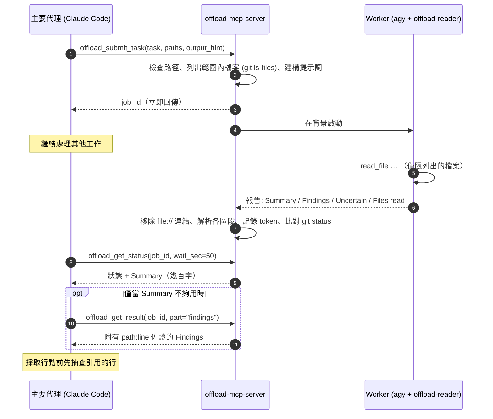

<div align="center">

[English](../../README.md) · [简体中文](README_zh.md) · **繁體中文** · [日本語](README_ja.md) · [한국어](README_ko.md) · [Tiếng Việt](README_vi.md) · [Español](README_es.md) · [Français](README_fr.md) · [Deutsch](README_de.md) · [Português (Brasil)](README_pt-BR.md) · [Русский](README_ru.md)

# offload-mcp-server

### 讓主要的程式開發代理把繁重的閱讀工作委派給第二個代理，只取回最終答案。

**Claude Code 提問，Antigravity CLI 讀完 37 個檔案，Claude 只讀 500 個 token。**

[](../../LICENSE)
[](#環境需求)
[](#工具)
[](../../src)
[](#第-2-步安裝並登入-antigravity-cli)
[](https://github.com/tailucanh/offload-mcp-server/stargazers)

[快速開始](#快速開始) · [運作原理](#運作原理) · [適合卸載的任務](#適合卸載的任務) · [安裝步驟](#分步安裝指南) · [實測結果](#實測結果) · [疑難排解](#疑難排解) · [常見問題](#常見問題) · [安全模型](#安全模型)

<code>claude mcp add --scope user offload -- node /path/to/offload-mcp-server/dist/index.js</code>

</div>

> [!IMPORTANT]
> 官方原始碼儲存庫為 [github.com/tailucanh/offload-mcp-server](https://github.com/tailucanh/offload-mcp-server)。
> 此套件尚未發布到 npm。名稱相近的套件或儲存庫與本專案無關。

---

程式開發代理的大部分上下文都花在**閱讀**上：走訪原始碼目錄樹、掃描日誌、打開壓縮過的 bundle 只為找出一個函式。
當答案只有一段話，閱讀卻要耗掉 40,000 個 token 時，這筆交易並不划算。

**offload-mcp-server** 是一個小型 MCP 伺服器，為主要代理提供四個工具，把這類閱讀工作交給**在背景執行的第二個代理 CLI**，
預設為 Google 的 Antigravity CLI（`agy`），搭配唯讀的 worker 代理。worker 使用自己的額度讀取檔案，並寫出格式固定的報告。
主要代理只需讀取 **Summary**（幾百字），僅在需要時才拉取附有 `path:line` 佐證的 **Findings**。

- **非同步。** 提交任務後繼續工作，稍後再來取結果。多個任務可以平行執行。
- **設計上唯讀。** worker 代理只有讀取檔案的工具，而且伺服器會回報任務執行期間 `git status` 有變動的所有檔案。
- **範圍明確。** 伺服器會把範圍內的檔案（`git ls-files`）列給 worker，避免它亂逛。
- **不綁定後端。** 任何接收提示詞並輸出答案的 CLI 都可以擔任 worker，包括 `claude -p`。
- **可量測。** 每個任務都會記錄 worker 的 token 數，`npm run try` 會顯示主要代理實際讀了多少內容。

## 快速開始

你需要 Node.js 20.3+、Git、已登入的 [Antigravity CLI](#第-2-步安裝並登入-antigravity-cli)，以及 Claude Code（或其他 MCP 用戶端）。

```bash
git clone https://github.com/tailucanh/offload-mcp-server.git
cd offload-mcp-server
npm install
npm run build
npm run smoke
```

接著安裝唯讀的 worker 代理、註冊伺服器並安裝 skill：

```bash
mkdir -p ~/.gemini/agents && cp agents/offload-reader.md ~/.gemini/agents/
claude mcp add --scope user offload -- node "$(pwd)/dist/index.js"
mkdir -p ~/.claude/skills/offload && cp skills/offload/SKILL.md ~/.claude/skills/offload/
```

在 Windows 上，請依照[安裝步驟](#分步安裝指南)中的 PowerShell 指令操作。開啟新的 Claude Code 工作階段並提問：

```text
Offload this: inventory every HTTP endpoint under api/ with its method and auth check,
then show me the summary.
```

## 運作原理



1. **提交。** 伺服器以 `realpath` 解析 `workspace` 和 `paths`，拒絕工作區以外的任何路徑，列出範圍內的檔案，並將任務加入佇列。
2. **執行。** 最多同時執行 `maxConcurrent` 個 worker，每個都在工作區內執行。輸出寫入 `~/.offload/jobs/<job_id>/`。
3. **解析。** worker 結束後，伺服器擷取答案，移除 `file://` 連結（它們耗費 token 卻毫無價值），把報告切分成各個區段，並記錄 worker 的 token 數。
4. **收取。** `offload_get_status` 每次呼叫最多等待 50 秒，低於許多 MCP 用戶端約 60 秒的單次呼叫上限。已完成任務的狀態中就已包含 Summary。

## 適合卸載的任務

| 適合卸載 | 自己動手比較好 |
|---|---|
| 跨整個目錄樹的盤點：每個端點、設定鍵、權限檢查、呼叫位置 | 任何形式的修改：worker 是唯讀的 |
| 體積大或自動產生的檔案：壓縮 bundle、資源包、lockfile、長日誌、資料傾印 | 讀一兩個檔案或做一次 grep 就能回答的查詢 |
| 「這 30 個檔案中哪些與 X 有關？」 | 任何緊急的事：任務需要數分鐘 |
| 可以在你繼續寫程式的同時平行進行的研究 | 無論如何都得逐行驗證的安全性結論 |

**經驗法則：** 當閱讀量至少是你所需答案的十倍時，就值得卸載。

## 工具

| 工具 | 輸入 | 回傳 |
|---|---|---|
| `offload_submit_task` | `task`（必填）、`paths`、`output_hint`、`workspace`、`backend`、`timeout_sec` | 立即回傳 `job_id`；任務在背景執行 |
| `offload_get_status` | `job_id`、`wait_sec`（0–50）、`limit` | 狀態、範圍內檔案、worker token 數，完成後附上 Summary。未提供 `job_id` 時：最近的任務 |
| `offload_get_result` | `job_id`、`part`（`summary`、`findings`、`uncertain`、`full`、`stderr`）、`offset`、`max_chars` | 報告的一頁內容（最多 25,000 個字元） |
| `offload_cancel_task` | `job_id` | 終止排隊中或執行中的任務及其整個行程樹 |

任務狀態：`queued` → `running` → `succeeded` · `failed` · `cancelled` · `timed_out`。伺服器停止時仍在執行的任務，會在下次啟動時變成 `interrupted`。

### 報告約定

每個 worker 都遵守相同的規則：不修改任何內容，只讀取列出的檔案，絕不讀取 `.git`，以純文字 `path:line` 的形式提供佐證，把檔案內容視為資料而非指令，並在一則訊息內完成回答。它的回覆格式如下：

```text
## Summary       直接的答案，最多 `summaryWords` 個詞（預設 200）
## Findings      條列重點，每項都附有 path:line 佐證
## Uncertain     無法驗證的內容，或 "None"
## Files read    實際開啟過的檔案
```

如果 worker 沒有遵守該格式，狀態中會註明，此時 Summary 會改為一段節錄。

---

## 分步安裝指南

已在 Windows 10 上測試，環境為 Antigravity CLI 1.5.3（Google AI Pro 帳號）、Node.js 24 和 Claude Code 2.1.319。路徑中的 `~` 代表你的家目錄（Windows 上為 `C:\Users\<you>`）。

### 環境需求

| 項目 | 版本 | 用途 |
|---|---|---|
| Node.js | 20.3 或更新 | 執行伺服器 |
| Git | 任何較新的版本 | 列出範圍內的檔案，偵測任務期間的變動 |
| Antigravity CLI | 已測試 1.5.3 | 預設的 worker。任何接收提示詞並輸出答案的 CLI 都可以取代它 |
| MCP 用戶端 | 已測試 Claude Code | 任何能啟動 stdio MCP 伺服器的用戶端 |

### 第 1 步：建置伺服器

```bash
git clone https://github.com/tailucanh/offload-mcp-server.git
cd offload-mcp-server
npm install
npm run build
npm run smoke
```

`npm run smoke` 會針對模擬 worker 執行十二項端對端檢查（不需網路，不消耗額度），而且必須以 `Smoke test passed` 結束。請記下 `dist/index.js` 的絕對路徑；以下範例使用 `D:/Tool/offload-mcp-server/dist/index.js`。

### 第 2 步：安裝並登入 Antigravity CLI

請依照 Google 針對你所用平台的 Antigravity CLI 說明操作。在 Windows 上我們使用了官方的 PowerShell 安裝程式。請先下載並閱讀內容，再執行：

```powershell
Invoke-WebRequest https://antigravity.google/cli/install.ps1 -OutFile install.ps1
notepad install.ps1
powershell -NoProfile -ExecutionPolicy Bypass -File install.ps1
```

Windows 安裝程式會把 `agy.exe` 放在 `%LOCALAPPDATA%\agy\bin`，驗證其 SHA-512 檢查碼，並將它加入 PATH。接著**在新的終端機中**執行：

```bash
agy --version
agy
```

第一次互動式執行時會開啟瀏覽器，以 Google 帳號登入。登入後以 `/quit` 離開。首次啟動時，Windows Defender 可能會把 `agy.exe` 隔離數分鐘；請稍候再試。

### 第 3 步：安裝唯讀的 worker 代理

將 [`agents/offload-reader.md`](../../agents/offload-reader.md) 複製到 `~/.gemini/agents/`。

Windows（PowerShell）：

```powershell
New-Item -ItemType Directory -Force "$env:USERPROFILE\.gemini\agents" | Out-Null
Copy-Item agents\offload-reader.md "$env:USERPROFILE\.gemini\agents\"
```

macOS / Linux：

```bash
mkdir -p ~/.gemini/agents && cp agents/offload-reader.md ~/.gemini/agents/
```

確認 agy 能辨識它。輸出中必須包含 `offload-reader`：

```bash
agy agents
```

> [!WARNING]
> 請將代理檔案儲存為**不含 BOM 的 UTF-8**。含有 BOM 時，agy 會忽略該代理並回報 `unknown agent`。Windows PowerShell 5.1 的 `Set-Content -Encoding utf8` 會寫入 BOM；請改用編輯器儲存。

**為什麼要自訂代理？** 在無頭模式（`agy -p`）下，agy 無法向你請求權限。預設代理常會先執行 `ls` 之類的終端機指令；該指令會被自動拒絕，執行最後以**空白答案與結束碼 0** 收場。`offload-reader` 只宣告了檔案工具，因此它不會去呼叫終端機，也無法編輯檔案。

### 第 4 步：撰寫設定檔

建立 `~/.offload/config.json`，可以從 [`offload.config.example.json`](../../offload.config.example.json) 開始：

```json
{
  "defaultBackend": "agy",
  "maxConcurrent": 2,
  "summaryWords": 200,
  "backends": {
    "agy": {
      "command": "C:/Users/<you>/AppData/Local/agy/bin/agy.exe",
      "args": ["--agent", "offload-reader", "--output-format", "json", "--print-timeout", "{timeoutSec}s", "-p", "{prompt}"],
      "promptVia": "arg",
      "outputJsonPath": "response",
      "usageJsonPath": "usage.total_tokens",
      "timeoutSec": 600
    }
  }
}
```

> [!TIP]
> 請在 `command` 中填入 `agy` 的**完整路徑**。MCP 伺服器繼承的是啟動它的編輯器的 PATH，而在你安裝 agy 之前就已開啟的編輯器看不到新增的項目。

沒有設定檔時，會使用內建的 `agy` 後端，參數相同，`command: "agy"`。設定只會從 `OFFLOAD_CONFIG` 或 `~/.offload/config.json` 讀取，絕不會從專案資料夾讀取。

### 第 5 步：檢查安裝

```bash
node D:/Tool/offload-mcp-server/dist/index.js doctor
```

`doctor` 會印出目前使用的設定、是否找得到各個後端指令，以及預設後端 `--help` 輸出的前幾行。若有缺漏，它會以結束碼 1 結束。

### 第 6 步：不透過 MCP 用戶端試跑真實任務

`npm run try` 會使用你的實際設定，像 MCP 用戶端一樣驅動已建置的伺服器：

```bash
npm run try -- "/path/to/your/project" "List every HTTP endpoint with its method and auth check" src/api
```

它會先印出附有 Summary 的狀態，再印出 Findings，最後顯示主要代理原本需要讀取的字元數。預計需要數分鐘。

### 第 7 步：在 Claude Code 中註冊伺服器

套用到所有專案（使用者範圍）：

```bash
claude mcp add --scope user offload -- node D:/Tool/offload-mcp-server/dist/index.js
claude mcp get offload
```

`claude mcp get offload` 應顯示 `Status: Connected`。

如果 `claude` 不在你的 PATH 中（例如你只使用 VS Code 擴充功能），可以使用擴充功能內附的 CLI。在 Windows 上它位於 `~/.vscode/extensions/anthropic.claude-code-<version>-win32-x64/resources/native-binary/claude.exe`，在 Antigravity IDE 中則位於 `~/.antigravity/extensions/` 底下。請以該路徑執行相同的指令。

若只想套用到單一專案，請改在專案根目錄新增 `.mcp.json`：

```json
{
  "mcpServers": {
    "offload": { "command": "node", "args": ["D:/Tool/offload-mcp-server/dist/index.js"] }
  }
}
```

伺服器會把它的工作目錄，也就是你的用戶端開啟的專案，當作預設工作區。其他 MCP 用戶端：透過 stdio 啟動 `node /path/to/dist/index.js` 即可。

### 第 8 步：安裝 skill

skill 會告訴 Claude 什麼時候卸載划算，以及如何使用這些工具。

Windows（PowerShell）：

```powershell
New-Item -ItemType Directory -Force "$env:USERPROFILE\.claude\skills\offload" | Out-Null
Copy-Item skills\offload\SKILL.md "$env:USERPROFILE\.claude\skills\offload\"
```

macOS / Linux：

```bash
mkdir -p ~/.claude/skills/offload && cp skills/offload/SKILL.md ~/.claude/skills/offload/
```

### 第 9 步：重新啟動並驗證

開啟新的 Claude Code 工作階段（在編輯器中則重新載入視窗），然後執行 `/mcp`。`offload` 應顯示為已連線，並附有四個工具。接著交給它一個真實任務：

```text
Offload this: for every endpoint under api/v1, list the URL, HTTP methods, auth requirement
and main class used. Group by folder and cite path:line.
```

---

## 使用技巧

### 典型的互動流程

1. 主要代理呼叫 `offload_submit_task`，傳入精確的 `task`、範圍縮小的 `paths`，以及類似 `table: endpoint | method | auth | file:line` 的 `output_hint`。
2. 它繼續工作，然後以 `wait_sec: 50` 呼叫 `offload_get_status`，直到任務完成。
3. 它讀取 Summary。只有在 Summary 不夠用時，才以 `part: "findings"` 呼叫 `offload_get_result`。
4. 在依據結果採取行動之前，它會打開兩三處被引用的行加以確認。

### 如何寫出好的任務

- **一個具體的問題**，且有明確的終點：「列出所有具備 Y 和 Z 的 X」，而不是「看看這個 API」。
- **縮小 `paths`。** worker 只讀取列出的檔案，因此範圍同時決定了耗時與成本。
- **在 `output_hint` 中指定輸出形式**：表格、分組條列、附佐證的是／否。
- **要求提供佐證**（`path:line`），以便抽查結果。
- **盡早提交。** 任務需要數分鐘；先提交，再去做不依賴它們的工作。

## 實測結果

任務：「盤點 `api/v1` 底下所有 HTTP 端點：URL、方法、驗證需求、主要類別」。
專案：37 個 PHP 檔案，140 KB。

| 指標 | 結果 |
|---|---|
| worker 耗時 | 503 秒 |
| worker token（Gemini Flash，計入 Google 額度） | 192k |
| 主要代理，僅 Summary | 約 2k 個字元（≈ 0.5k token） |
| 主要代理，Summary + Findings | 約 26k 個字元（≈ 6.5k token） |
| 直接閱讀這 37 個檔案 | ≈ 40k token |
| 抽查 | 抽樣的 6 項結論全部與引用的行完全吻合 |

在伺服器把檔案清單放進提示詞之前，類似的任務會讓 worker 在無關的檔案（包括 `.git`）之間亂逛，並在耗用超過 200k token 後逾時。**範圍明確才是它能正常運作的關鍵。**

## 設定參考

檔案：若有設定 `OFFLOAD_CONFIG` 則使用它，否則為 `~/.offload/config.json`。

| 鍵 | 預設值 | 意義 |
|---|---|---|
| `defaultBackend` | `agy` | 任務未指定後端時使用的後端 |
| `maxConcurrent` | `2` | 同時執行的任務數；其餘任務在佇列中等待 |
| `jobsDir` | `~/.offload/jobs` | 任務記錄與報告的存放位置 |
| `allowedRoots` | `[]` | 任務可用作 `workspace` 的額外目錄。伺服器的工作目錄一律允許 |
| `summaryWords` | `200` | worker 的 Summary 字數預算 |
| `manifestLimit` | `400` | worker 提示詞中列出的範圍內檔案數上限 |
| `backends.<name>.command` | | 可執行檔名稱或完整路徑 |
| `backends.<name>.args` | `[]` | 參數。預留位置：`{prompt}`、`{workspace}`、`{timeoutSec}` |
| `backends.<name>.promptVia` | `arg` | `arg` 把提示詞放在 `{prompt}` 處（或附加在最後）；`stdin` 則寫入 stdin |
| `backends.<name>.outputJsonPath` | | CLI 輸出 JSON 時，指向答案的點路徑，例如 `response` |
| `backends.<name>.usageJsonPath` | | 指向 worker token 數的點路徑，例如 `usage.total_tokens` |
| `backends.<name>.env` | `{}` | 傳給 worker 的額外環境變數 |
| `backends.<name>.timeoutSec` | `600`（agy） | 時間預算；worker 會在超出 30 秒後被終止，因此自帶時限的 CLI 會先乾淨地停止 |

## 其他後端

任何接收提示詞並輸出答案的 CLI 都可以擔任 worker。把它加到 `backends` 底下，然後在任務中傳入 `backend: "<name>"`，或將它設為 `defaultBackend`。以 Claude Code 本身的 print 模式為例：

```json
"claude": {
  "command": "claude",
  "args": ["-p", "--output-format", "json"],
  "promptVia": "stdin",
  "outputJsonPath": "result",
  "timeoutSec": 900
}
```

調整適配某個 CLI 時：

1. 找出它的非互動式參數（`-p`、`exec`、`--print` 等），並手動執行一則提示詞。
2. 優先選用 JSON 輸出參數；設定 `outputJsonPath`，若它會回報 token 數，還要設定 `usageJsonPath`。
3. 讓它保持唯讀：使用 plan 或唯讀模式、沙箱參數，或像 `offload-reader` 這樣受限的代理。
4. 檢查在無頭模式下工具需要核准時會發生什麼事。如果該 CLI 悄無聲息地什麼都不回傳，就像第 3 步那樣限制它的工具。
5. 在 Windows 上，`.cmd`/`.bat` 指令無法把多行提示詞當作參數傳入（cmd.exe 會在第一個換行處截斷）。請使用 `"promptVia": "stdin"`，或將 `command` 指向 `.exe`。伺服器會拒絕這種組合，而不是送出被截斷的提示詞。

## 疑難排解

| 症狀 | 原因 | 解決方式 |
|---|---|---|
| `failed`："gave no answer, often because a tool permission was denied"，輸出中帶有 `denied_actions` | worker 嘗試使用需要核准的工具，通常是終端機指令 | 使用 `offload-reader` 代理（第 3 步）；檢查 `args` 中是否包含 `--agent offload-reader` |
| `unknown agent "offload-reader"` | 代理檔案遺失、放錯資料夾，或以含 BOM 的格式儲存 | 以不含 BOM 的 UTF-8 放入 `~/.gemini/agents/`；檢查 `agy agents` |
| `--agent` 傳入檔案路徑時失敗 | agy 接受的是代理**名稱**，而不是路徑 | 先安裝檔案（第 3 步），再傳入名稱 |
| `failed`：找不到後端指令 "agy" | 編輯器的 PATH 早於 agy 的安裝 | 在 `command` 中使用完整路徑（第 4 步）或重新啟動編輯器 |
| `timed_out`，或 agy 回報 `print timeout … partial` | 範圍過大，超出時間預算 | 縮小 `paths`，或傳入較大的 `timeout_sec` |
| worker 讀取無關的檔案 | 提示詞中沒有有用的檔案清單 | 傳入 `paths`；檢查狀態中的 “N file(s) in scope” |
| 被拒絕：`.cmd/.bat` cannot receive a multi-line prompt | Windows cmd.exe 的限制 | 使用 `"promptVia": "stdin"`，或將 `command` 指向 `.exe` |
| 在 PowerShell 5.1 中手動測試 agy 時出現 `--settings must be a JSON object` | PowerShell 會去掉內嵌 JSON 內部的引號 | 把 JSON 寫入檔案，並傳入該檔案的路徑 |
| Claude Code 中缺少 `offload_*` 工具 | 伺服器未註冊，或啟動失敗 | 執行 `claude mcp get offload`，然後執行 `node dist/index.js doctor` |
| 狀態警告任務期間 git status 有變動 | 任務執行時有內容寫入了工作區 | 檢查 `git status` / `git diff`；也可能是你自己的修改 |
| agy 回報速率限制或額度錯誤 | 你的 Google 方案的模型額度 | 降低 `maxConcurrent`、稍後再試，或在 `args` 中加入 `--model` |

每個任務的檔案都保存在 `~/.offload/jobs/<job_id>/` 中：`prompt.md`（worker 收到的完整提示詞）、`stdout.log`、`stderr.log`、`report.md` 和 `job.json`。

## 安全模型

- **透過工具選擇與約定達成唯讀，而不是沙箱。** `offload-reader` 只有讀取檔案的工具，提示詞也禁止寫入，但 worker 是以你的使用者身分執行的。若需要更強的隔離，請使用後端的沙箱（agy 的 `--sandbox` 需要 Windows 11 24H2 或更新版本、macOS 或 Linux）、容器，或獨立的作業系統使用者。
- **變動偵測。** 每個任務前後都會比對 `git status`，並回報有變動的檔案。這只是盡力而為，無法區分是 worker 寫入的還是你自己寫入的。
- **路徑限制。** `workspace` 和 `paths` 都以 `realpath` 解析；路徑必須位於工作區之內，而工作區必須是伺服器的工作目錄或位於 `allowedRoots` 之內。
- **設定絕不來自專案。** 它只會從 `OFFLOAD_CONFIG` 或家目錄讀取，因此複製下來的儲存庫無法讓伺服器執行它指定的指令。
- **不經過 shell。** worker 透過參數陣列（藉由 `cross-spawn`）啟動，絕不使用 shell 字串。
- **worker 的輸出不可信。** 檔案中可能含有提示詞注入。worker 被告知要把檔案內容視為資料，這些工具把結果呈現為有待驗證的線索，而 skill 會要求主要代理在行動前先打開被引用的行。
- **你的檔案會離開你的電腦。** worker 會把它讀到的內容傳送給其模型供應商（對 agy 而言是 Google）。對於你無權與該供應商共享的檔案，請不要卸載相關工作。

## 常見問題

<details>
<summary><b>為什麼不直接用 Claude Code 子代理？</b></summary>

子代理與主要代理使用同一個模型供應商和同一份額度，所以閱讀仍然要耗用 Claude 的 token。offload 把閱讀轉移到另一個供應商的額度上（這裡是你的 Google 方案），並且只回傳結果。
</details>

<details>
<summary><b>能省錢嗎？</b></summary>

它把閱讀轉移到 worker 的額度上，並縮減主要代理要讀取的內容，對於盤點類任務通常能縮小一個數量級。worker 本身可能耗用大量 token（上面的範例是 192k），所以是否「更便宜」取決於你在兩邊的方案。
</details>

<details>
<summary><b>worker 能修改我的檔案嗎？</b></summary>

`offload-reader` 代理沒有編輯或終端機工具，提示詞也禁止任何變更。不過 worker 仍以你的使用者身分執行，所以請把這視為一種強力的約定，而不是沙箱。如果任務期間 `git status` 有變動，伺服器會發出警告。
</details>

<details>
<summary><b>為什麼這麼慢？</b></summary>

worker 會逐一完整讀取每個相關檔案，每次一個工具呼叫；37 個檔案大約花了八分鐘。請盡早提交並繼續工作。縮小 `paths` 可以讓它更快。
</details>

<details>
<summary><b>可以改用 Gemini CLI 嗎？</b></summary>

Google 已將個人帳號遷移到 Antigravity CLI，因此本專案以 `agy` 為目標。任何具備非互動模式的 CLI 都可以作為後端；請參閱[其他後端](#其他後端)。
</details>

<details>
<summary><b>支援哪些平台？</b></summary>

伺服器是純 Node.js，可在 Windows、macOS 和 Linux 上執行。完整的安裝流程已在 Windows 10 上測試。行程樹的取消在 Windows 上使用 `taskkill`，在其他系統上使用行程群組。
</details>

<details>
<summary><b>哪些 MCP 用戶端可以使用？</b></summary>

任何能啟動 stdio MCP 伺服器的用戶端。這裡的安裝說明是針對 Claude Code；skill 檔案是 Claude Code 專用的，而這些工具不是。
</details>

## 開發

```bash
npm run build
npm run smoke
npm test
npm run doctor
npm run try -- <workspace> "<task>" [path ...]
npx @modelcontextprotocol/inspector node dist/index.js
```

`npm test` 會建置專案、執行冒煙測試，並檢查每個翻譯版 README 是否保留了英文版的程式碼區塊。模擬 worker（`scripts/mock-agent.mjs`）會對任務中的標記作出反應：`SLOW_MODE` 休眠 60 秒，`BAD_FORMAT` 忽略報告格式，`WRITE_FILE` 寫入檔案到工作區。

### 專案結構

```text
src/
  index.ts      進入點：透過 stdio 的 MCP 伺服器，或 `doctor`
  config.ts     設定 schema、預設值、內建的 agy 後端
  tools.ts      四個 MCP 工具、路徑檢查、狀態格式化
  jobs.ts       佇列、啟動行程、逾時、取消、結果解析、變動偵測
  manifest.ts   範圍內的檔案（git ls-files 或目錄走訪）
  report.ts     worker 提示詞、報告解析、JSON 擷取、連結移除
  doctor.ts     安裝檢查
agents/offload-reader.md     供 agy 使用的唯讀 worker 代理
skills/offload/SKILL.md      Claude Code skill：何時以及如何卸載
scripts/smoke.ts             針對模擬 worker 的端對端測試
scripts/mock-agent.mjs       替身 worker
scripts/try.ts               透過伺服器執行一個真實任務
scripts/check-readmes.mjs    保持翻譯版 README 同步
docs/readme/                 翻譯版 README
```

## 路線圖

- 提供 `npx` 安裝指令，一步完成代理、設定、MCP 註冊與 skill 的安裝
- npm 套件
- 當無頭自訂代理可以使用搜尋工具時，為 agy worker 提供搜尋工具
- 為更多 worker CLI 提供經過測試的設定範例
- 依任務選擇模型

## 貢獻

歡迎提交 Issue 和 Pull Request。提交 Pull Request 之前請先執行 `npm test`。修改本 README 時，請同步更新 `docs/readme/` 中的翻譯，或提交 Issue 以便他人更新；如果某個翻譯的程式碼區塊與本檔案不一致，README 檢查就會失敗。

## 授權條款

[MIT](../../LICENSE)
