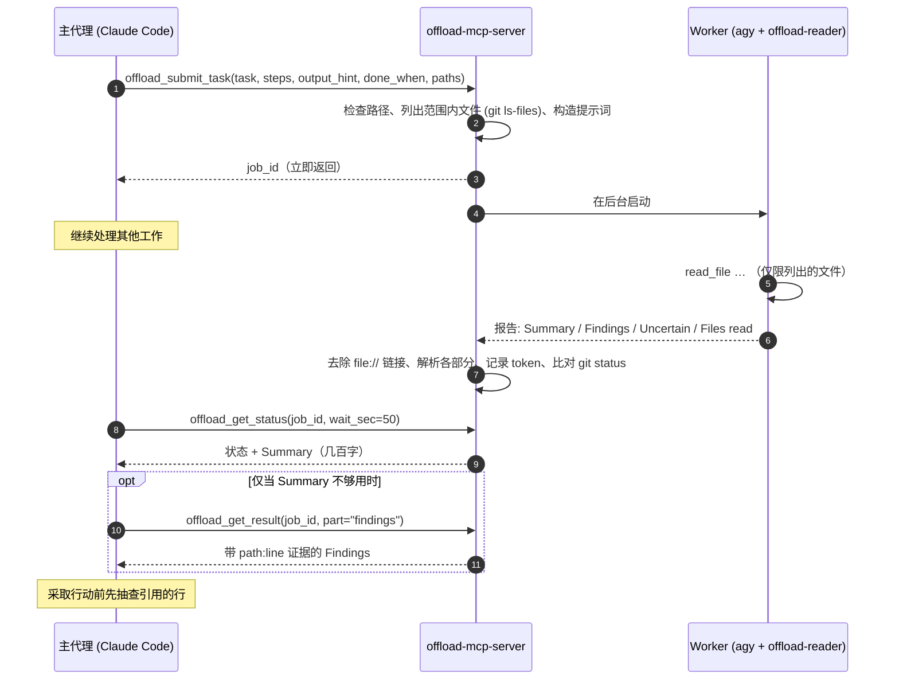

<div align="center">

[English](../../README.md) · **简体中文** · [繁體中文](README_zh-TW.md) · [日本語](README_ja.md) · [한국어](README_ko.md) · [Tiếng Việt](README_vi.md) · [Español](README_es.md) · [Français](README_fr.md) · [Deutsch](README_de.md) · [Português (Brasil)](README_pt-BR.md) · [Русский](README_ru.md)

# offload-mcp-server

### 让主编码代理把繁重的阅读工作委派给第二个代理，只取回最终答案。

**Claude Code 提问，Antigravity CLI 读完 37 个文件，Claude 只读 500 个 token。**

[](https://www.npmjs.com/package/offload-mcp-server)
[](../../LICENSE)
[](#环境要求)
[](#工具)
[](../../src)
[](#第-2-步安装并登录-antigravity-cli)
[](https://github.com/tailucanh/offload-mcp-server/stargazers)

[快速开始](#快速开始) · [工作原理](#工作原理) · [适合卸载的任务](#适合卸载的任务) · [安装步骤](#分步安装指南) · [实测结果](#实测结果) · [故障排查](#故障排查) · [常见问题](#常见问题) · [安全模型](#安全模型)

<code>npx -y offload-mcp-server setup</code>



</div>

> [!IMPORTANT]
> 官方源码仓库是 [github.com/tailucanh/offload-mcp-server](https://github.com/tailucanh/offload-mcp-server)。
> npm 包名为 [`offload-mcp-server`](https://www.npmjs.com/package/offload-mcp-server)。名称相似的包或仓库都不是本项目。

---

编码代理的大部分上下文都花在**阅读**上：遍历源码树、扫描日志、打开压缩后的 bundle 只为找一个函数。
当答案只有一段话，而阅读却消耗 40,000 个 token 时，这笔买卖很不划算。

**offload-mcp-server** 是一个小巧的 MCP 服务器，为主代理提供四个工具，把这类阅读工作交给**在后台运行的第二个代理 CLI**，
默认是 Google 的 Antigravity CLI（`agy`），搭配一个只读的 worker 代理。worker 使用它自己的额度读取文件，并写出格式固定的报告。
主代理只需读取 **Summary**（几百字），仅在需要时才拉取带有 `path:line` 证据的 **Findings**。

- **异步。** 提交任务后继续干活，稍后再来取结果。多个任务可以并行运行。
- **设计上只读。** worker 代理只有读取文件的工具，并且服务器会报告任务运行期间 `git status` 发生变化的所有文件。
- **范围明确。** 服务器会把作用范围内的文件（`git ls-files`）列给 worker，避免它乱逛。
- **不绑定后端。** 任何接收提示词并输出答案的 CLI 都可以充当 worker，包括 `claude -p`。
- **可度量。** 每个任务都会记录 worker 的 token 数，`npm run try` 会显示主代理实际读取了多少内容。

## 快速开始

你需要 Node.js 20.3+、已安装并登录的 [Antigravity CLI](#第-2-步安装并登录-antigravity-cli)，以及 Claude Code（或其他 MCP 客户端）。然后运行：

```bash
npx -y offload-mcp-server setup
```

`setup` 会查找 Antigravity CLI，安装只读 worker 代理（`~/.gemini/agents/`）和 Claude Code 技能（`~/.claude/skills/offload/`），在 `~/.offload/config.json` 不存在时创建它，并把服务器注册到 Claude Code。更新后可以放心重复运行：被改动过的文件会先保存为 `.bak`。加上 `--dry-run` 可预览它将执行的操作。

启动新的 Claude Code 会话（或重新加载编辑器窗口），然后提问：

```text
Offload this: inventory every HTTP endpoint under api/ with its method and auth check,
then show me the summary.
```

如果要从克隆的仓库运行（用于开发）：

```bash
git clone https://github.com/tailucanh/offload-mcp-server.git
cd offload-mcp-server
npm install
npm run build
node dist/index.js setup
```

[安装步骤](#分步安装指南) 解释了每个部分以及如何手动完成。

## 工作原理



1. **提交。** 服务器用 `realpath` 解析 `workspace` 和 `paths`，拒绝工作区之外的任何路径，列出范围内的文件，并将任务入队。
2. **运行。** 最多同时运行 `maxConcurrent` 个 worker，每个都在工作区内运行。输出写入 `~/.offload/jobs/<job_id>/`。
3. **解析。** worker 退出后，服务器提取答案，去除 `file://` 链接（它们消耗 token 却没有任何价值），把报告拆分为各个部分，并记录 worker 的 token 数。
4. **收取。** `offload_get_status` 每次调用最多等待 50 秒，低于许多 MCP 客户端约 60 秒的单次调用上限。已完成任务的状态里已经包含 Summary。

## 适合卸载的任务

| 适合卸载 | 自己动手更合适 |
|---|---|
| 跨整个目录树的盘点：每个端点、配置键、权限检查、调用点 | 任何形式的修改：worker 是只读的 |
| 体积大或自动生成的文件：压缩 bundle、资源包、lockfile、长日志、数据转储 | 读一两个文件或一次 grep 就能回答的查询 |
| “这 30 个文件里哪些与 X 有关？” | 任何紧急的事：任务需要几分钟 |
| 可以在你继续编码的同时并行进行的调研 | 无论如何都要逐行核实的安全结论 |

**经验法则：** 当阅读量至少是你所需答案的十倍时，就值得卸载。

## 工具

| 工具 | 输入 | 返回 |
|---|---|---|
| `offload_submit_task` | `task`、`steps`、`output_hint`、`done_when`（四项必填）；`context`、`exclude`、`paths`、`workspace`、`backend`、`timeout_sec` | 立即返回 `job_id`；任务在后台运行 |
| `offload_get_status` | `job_id`、`wait_sec`（0–50）、`limit` | 状态、范围内文件、worker token 数，完成后附带 Summary。不带 `job_id` 时：最近的任务 |
| `offload_get_result` | `job_id`、`part`（`summary`、`findings`、`steps`、`uncertain`、`full`、`stderr`）、`offset`、`max_chars` | 报告的一页内容（最多 25,000 个字符） |
| `offload_cancel_task` | `job_id` | 终止排队中或运行中的任务及其整个进程树 |

任务状态：`queued` → `running` → `succeeded` · `failed` · `cancelled` · `timed_out`。服务器停止时仍在运行的任务，会在下次启动时变为 `interrupted`。

### 报告约定

每个 worker 都遵守相同的规则：不修改任何内容，只读取列出的文件，绝不读取 `.git`，以纯文本 `path:line` 的形式给出证据，把文件内容当作数据而不是指令，并在一条消息内完成回答。它的回复格式如下：

```text
## Summary       直接的答案，最多 `summaryWords` 个词（默认 200）
## Findings      要点列表，每条都带有 path:line 证据
## Step log      每个步骤一行：done、partial 或 not done
## Uncertain     无法核实的内容，或 "None"
## Files read    实际打开过的文件
```

如果 worker 没有遵守该格式，状态中会注明，此时 Summary 会改为一段节选。

---

## 分步安装指南

在 Windows 10 上测试通过，环境为 Antigravity CLI 1.5.3（Google AI Pro 账号）、Node.js 24 和 Claude Code 2.1.319。路径中的 `~` 表示你的主目录（Windows 上为 `C:\Users\<you>`）。

> [!TIP]
> `npx -y offload-mcp-server setup` 会替你完成第 3、4、7、8 步。下面的步骤说明它做了什么，以及如何手动完成。

### 环境要求

| 项目 | 版本 | 用途 |
|---|---|---|
| Node.js | 20.3 或更高 | 运行服务器 |
| Git | 任意较新版本 | 列出范围内的文件，检测任务期间的变更 |
| Antigravity CLI | 已测试 1.5.3 | 默认的 worker。任何接收提示词并输出答案的 CLI 都可以替代它 |
| MCP 客户端 | 已测试 Claude Code | 任何能启动 stdio MCP 服务器的客户端 |

### 第 1 步：构建服务器

```bash
git clone https://github.com/tailucanh/offload-mcp-server.git
cd offload-mcp-server
npm install
npm run build
npm run smoke
```

`npm run smoke` 会针对模拟 worker 运行十二项端到端检查（无需网络，不消耗额度），并且必须以 `Smoke test passed` 结束。请记下 `dist/index.js` 的绝对路径；下面的示例使用 `D:/Tool/offload-mcp-server/dist/index.js`。

### 第 2 步：安装并登录 Antigravity CLI

请按照 Google 针对你所用平台的 Antigravity CLI 说明操作。在 Windows 上我们使用了官方 PowerShell 安装脚本。请先下载并阅读脚本，再运行：

```powershell
Invoke-WebRequest https://antigravity.google/cli/install.ps1 -OutFile install.ps1
notepad install.ps1
powershell -NoProfile -ExecutionPolicy Bypass -File install.ps1
```

Windows 安装程序会把 `agy.exe` 放到 `%LOCALAPPDATA%\agy\bin`，校验其 SHA-512 校验和，并将其加入 PATH。然后**在新的终端中**运行：

```bash
agy --version
agy
```

首次交互式运行会打开浏览器，用 Google 账号登录。登录后用 `/quit` 退出。首次启动时，Windows Defender 可能会把 `agy.exe` 隔离几分钟；请稍等后重试。

### 第 3 步：安装只读 worker 代理

将 [`agents/offload-reader.md`](../../agents/offload-reader.md) 复制到 `~/.gemini/agents/`。

Windows（PowerShell）：

```powershell
New-Item -ItemType Directory -Force "$env:USERPROFILE\.gemini\agents" | Out-Null
Copy-Item agents\offload-reader.md "$env:USERPROFILE\.gemini\agents\"
```

macOS / Linux：

```bash
mkdir -p ~/.gemini/agents && cp agents/offload-reader.md ~/.gemini/agents/
```

检查 agy 能否识别它。输出中必须包含 `offload-reader`：

```bash
agy agents
```

> [!WARNING]
> 请将代理文件保存为**不带 BOM 的 UTF-8**。带 BOM 时，agy 会忽略该代理并报告 `unknown agent`。Windows PowerShell 5.1 的 `Set-Content -Encoding utf8` 会写入 BOM；请改用编辑器保存。

**为什么要自定义代理？** 在无头模式（`agy -p`）下，agy 无法向你请求权限。默认代理常常会先执行 `ls` 之类的终端命令；该命令会被自动拒绝，运行最终以**空答案和退出码 0** 结束。`offload-reader` 只声明了文件工具，因此它不会去调用终端，也无法编辑文件。

### 第 4 步：编写配置文件

创建 `~/.offload/config.json`，可以从 [`offload.config.example.json`](../../offload.config.example.json) 开始：

```json
{
  "defaultBackend": "agy",
  "maxConcurrent": 2,
  "summaryWords": 200,
  "backends": {
    "agy": {
      "command": "C:/Users/<you>/AppData/Local/agy/bin/agy.exe",
      "args": ["--agent", "offload-reader", "--output-format", "json", "--print-timeout", "{timeoutSec}s", "-p", "{prompt}"],
      "promptVia": "arg",
      "outputJsonPath": "response",
      "usageJsonPath": "usage.total_tokens",
      "timeoutSec": 600
    }
  }
}
```

> [!TIP]
> 请在 `command` 中填写 `agy` 的**完整路径**。MCP 服务器继承的是启动它的编辑器的 PATH，而在你安装 agy 之前就已打开的编辑器看不到新增的条目。

没有配置文件时，会使用内置的 `agy` 后端，参数相同，`command: "agy"`。配置只会从 `OFFLOAD_CONFIG` 或 `~/.offload/config.json` 读取，绝不会从项目文件夹读取。

### 第 5 步：检查安装

```bash
node D:/Tool/offload-mcp-server/dist/index.js doctor
```

`doctor` 会打印当前使用的配置、是否能找到各个后端命令，以及默认后端 `--help` 输出的前几行。如果有缺失项，它会以退出码 1 结束。

### 第 6 步：不借助 MCP 客户端试跑真实任务

`npm run try` 会使用你的真实配置，像 MCP 客户端一样驱动已构建的服务器：

```bash
npm run try -- "/path/to/your/project" "List every HTTP endpoint with its method and auth check" src/api
```

它会先打印带有 Summary 的状态，再打印 Findings，最后给出主代理本来需要读取的字符数。预计需要几分钟。

### 第 7 步：在 Claude Code 中注册服务器

对所有项目生效（用户范围）：

```bash
claude mcp add --scope user offload -- node D:/Tool/offload-mcp-server/dist/index.js
claude mcp get offload
```

`claude mcp get offload` 应当显示 `Status: Connected`。

如果 `claude` 不在你的 PATH 中（例如你只使用 VS Code 扩展），可以使用扩展自带的 CLI。在 Windows 上它位于 `~/.vscode/extensions/anthropic.claude-code-<version>-win32-x64/resources/native-binary/claude.exe`，在 Antigravity IDE 中则位于 `~/.antigravity/extensions/` 下。请用该路径运行同样的命令。

如果只想对单个项目生效，请改为在项目根目录添加 `.mcp.json`：

```json
{
  "mcpServers": {
    "offload": { "command": "node", "args": ["D:/Tool/offload-mcp-server/dist/index.js"] }
  }
}
```

服务器把它的工作目录，也就是你的客户端打开的项目，作为默认工作区。其他 MCP 客户端：通过 stdio 启动 `node /path/to/dist/index.js` 即可。

### 第 8 步：安装 skill

skill 会告诉 Claude 什么时候卸载划算，以及如何使用这些工具。

Windows（PowerShell）：

```powershell
New-Item -ItemType Directory -Force "$env:USERPROFILE\.claude\skills\offload" | Out-Null
Copy-Item skills\offload\SKILL.md "$env:USERPROFILE\.claude\skills\offload\"
```

macOS / Linux：

```bash
mkdir -p ~/.claude/skills/offload && cp skills/offload/SKILL.md ~/.claude/skills/offload/
```

### 第 9 步：重启并验证

启动一个新的 Claude Code 会话（在编辑器中则重新加载窗口），然后运行 `/mcp`。`offload` 应显示为已连接，并带有四个工具。接着交给它一个真实任务：

```text
Offload this: for every endpoint under api/v1, list the URL, HTTP methods, auth requirement
and main class used. Group by folder and cite path:line.
```

---

## 使用技巧

### 典型交互流程

1. 主代理调用 `offload_submit_task`，传入精确的 `task`、范围收窄的 `paths`，以及类似 `table: endpoint | method | auth | file:line` 的 `output_hint`。
2. 它继续干活，然后以 `wait_sec: 50` 调用 `offload_get_status`，直到任务完成。
3. 它读取 Summary。只有在 Summary 不够用时，才以 `part: "findings"` 调用 `offload_get_result`。
4. 在依据结果采取行动之前，它会打开两三处被引用的行进行确认。

### 如何写好任务

- **一个具体的问题**，且有明确的终点：“列出所有带 Y 和 Z 的 X”，而不是“看看这个 API”。
- **收窄 `paths`。** worker 只读取列出的文件，所以范围同时决定了耗时和成本。
- **写完整的任务说明（brief）。** `steps`（按顺序的具体操作）、`output_hint` 和 `done_when` 必填；`context`（你已知道的信息）和 `exclude` 可选。worker 只执行这些步骤，不做其他事，并把每一步记为 done、partial 或 not done；状态中的 *Brief check* 行会指出未完成的步骤。
- **在 `output_hint` 中指定输出形态**：表格、分组要点、带证据的是/否。
- **要求给出证据**（`path:line`），以便抽查结果。
- **尽早提交。** 任务需要几分钟；先提交，再去做不依赖它们的工作。

## 实测结果

任务：“盘点 `api/v1` 下的所有 HTTP 端点：URL、方法、鉴权要求、主要类”。
项目：37 个 PHP 文件，140 KB。

| 指标 | 结果 |
|---|---|
| worker 耗时 | 503 秒 |
| worker token（Gemini Flash，计入 Google 额度） | 192k |
| 主代理，仅 Summary | 约 2k 个字符（≈ 0.5k token） |
| 主代理，Summary + Findings | 约 26k 个字符（≈ 6.5k token） |
| 直接阅读这 37 个文件 | ≈ 40k token |
| 抽查 | 抽样的 6 条结论全部与引用的行完全吻合 |

在服务器把文件列表写入提示词之前，类似的任务会让 worker 在无关文件（包括 `.git`）之间乱逛，并在消耗超过 200k token 后超时。**范围明确才是它能正常工作的关键。**

## 配置参考

文件：若设置了 `OFFLOAD_CONFIG` 则使用它，否则为 `~/.offload/config.json`。

| 键 | 默认值 | 含义 |
|---|---|---|
| `defaultBackend` | `agy` | 任务未指定后端时使用的后端 |
| `maxConcurrent` | `2` | 同时运行的任务数；其余任务在队列中等待 |
| `jobsDir` | `~/.offload/jobs` | 任务记录和报告的存放位置 |
| `allowedRoots` | `[]` | 任务可用作 `workspace` 的额外目录。服务器的工作目录始终被允许 |
| `summaryWords` | `200` | worker 的 Summary 字数预算 |
| `manifestLimit` | `400` | worker 提示词中列出的范围内文件数上限 |
| `backends.<name>.command` | | 可执行文件名或完整路径 |
| `backends.<name>.args` | `[]` | 参数。占位符：`{prompt}`、`{workspace}`、`{timeoutSec}` |
| `backends.<name>.promptVia` | `arg` | `arg` 把提示词放在 `{prompt}` 处（或追加在末尾）；`stdin` 则写入 stdin |
| `backends.<name>.outputJsonPath` | | CLI 输出 JSON 时，指向答案的点路径，例如 `response` |
| `backends.<name>.usageJsonPath` | | 指向 worker token 数的点路径，例如 `usage.total_tokens` |
| `backends.<name>.env` | `{}` | 传给 worker 的额外环境变量 |
| `backends.<name>.timeoutSec` | `600`（agy） | 时间预算；worker 会在超出 30 秒后被终止，因此自带时限的 CLI 会先干净地停止 |

## 其他后端

任何接收提示词并输出答案的 CLI 都可以充当 worker。把它添加到 `backends` 下，然后在任务中传入 `backend: "<name>"`，或将其设为 `defaultBackend`。以 Claude Code 自身的 print 模式为例：

```json
"claude": {
  "command": "claude",
  "args": ["-p", "--output-format", "json"],
  "promptVia": "stdin",
  "outputJsonPath": "result",
  "timeoutSec": 900
}
```

适配某个 CLI 时：

1. 找到它的非交互式参数（`-p`、`exec`、`--print` 等），并手动运行一条提示词。
2. 优先选择 JSON 输出参数；设置 `outputJsonPath`，如果它会报告 token 数，还要设置 `usageJsonPath`。
3. 让它保持只读：使用 plan 或只读模式、沙箱参数，或像 `offload-reader` 这样受限的代理。
4. 检查在无头模式下工具需要审批时会发生什么。如果该 CLI 悄无声息地什么都不返回，就像第 3 步那样限制它的工具。
5. 在 Windows 上，`.cmd`/`.bat` 命令无法把多行提示词作为参数传入（cmd.exe 会在第一个换行处截断）。请使用 `"promptVia": "stdin"`，或将 `command` 指向 `.exe`。服务器会拒绝这种组合，而不是发送被截断的提示词。

## 故障排查

| 现象 | 原因 | 解决办法 |
|---|---|---|
| `failed`："gave no answer, often because a tool permission was denied"，输出中带有 `denied_actions` | worker 尝试使用需要审批的工具，通常是终端命令 | 使用 `offload-reader` 代理（第 3 步）；检查 `args` 中是否包含 `--agent offload-reader` |
| `unknown agent "offload-reader"` | 代理文件缺失、放错了文件夹，或带 BOM 保存 | 以不带 BOM 的 UTF-8 放入 `~/.gemini/agents/`；检查 `agy agents` |
| `--agent` 传入文件路径时失败 | agy 接受的是代理**名称**，而不是路径 | 先安装文件（第 3 步），再传入名称 |
| `failed`：找不到后端命令 "agy" | 编辑器的 PATH 早于 agy 的安装 | 在 `command` 中使用完整路径（第 4 步）或重启编辑器 |
| `timed_out`，或 agy 报告 `print timeout … partial` | 范围过大，超出时间预算 | 收窄 `paths`，或传入更大的 `timeout_sec` |
| worker 读取无关文件 | 提示词中没有有用的文件列表 | 传入 `paths`；检查状态中的 “N file(s) in scope” |
| 被拒绝：`.cmd/.bat` cannot receive a multi-line prompt | Windows cmd.exe 的限制 | 使用 `"promptVia": "stdin"`，或将 `command` 指向 `.exe` |
| 在 PowerShell 5.1 中手动测试 agy 时出现 `--settings must be a JSON object` | PowerShell 会去掉内联 JSON 内部的引号 | 把 JSON 写入文件，并传入该文件的路径 |
| Claude Code 中缺少 `offload_*` 工具 | 服务器未注册，或启动失败 | 运行 `claude mcp get offload`，然后运行 `node dist/index.js doctor` |
| 状态警告任务期间 git status 发生了变化 | 任务运行时有内容写入了工作区 | 检查 `git status` / `git diff`；也可能是你自己的修改 |
| agy 报告速率限制或额度错误 | 你的 Google 套餐的模型额度 | 降低 `maxConcurrent`、稍后重试，或在 `args` 中添加 `--model` |

每个任务的文件都保存在 `~/.offload/jobs/<job_id>/` 中：`prompt.md`（worker 收到的完整提示词）、`stdout.log`、`stderr.log`、`report.md` 和 `job.json`。

## 安全模型

- **通过工具选择和约定实现只读，而不是沙箱。** `offload-reader` 只有读取文件的工具，提示词也禁止写入，但 worker 是以你的用户身份运行的。若需要更强的隔离，请使用后端的沙箱（agy 的 `--sandbox` 需要 Windows 11 24H2 或更高版本、macOS 或 Linux）、容器，或单独的操作系统用户。
- **变更检测。** 每个任务前后都会比对 `git status`，并报告发生变化的文件。这只是尽力而为，无法区分是 worker 写入的还是你自己写入的。
- **路径约束。** `workspace` 和 `paths` 都用 `realpath` 解析；路径必须位于工作区之内，而工作区必须是服务器的工作目录或位于 `allowedRoots` 之内。
- **配置绝不来自项目。** 它只从 `OFFLOAD_CONFIG` 或主目录读取，因此克隆下来的仓库无法让服务器运行它指定的命令。
- **不经过 shell。** worker 通过参数数组（借助 `cross-spawn`）启动，绝不使用 shell 字符串。
- **worker 的输出不可信。** 文件中可能包含提示词注入。worker 被告知要把文件内容当作数据，这些工具把结果呈现为有待核实的线索，而 skill 会要求主代理在行动前先打开被引用的行。
- **你的文件会离开你的机器。** worker 会把它读到的内容发送给其模型提供方（对 agy 来说是 Google）。对于你无权与该提供方共享的文件，请不要卸载相关工作。

## 常见问题

<details>
<summary><b>为什么不直接用 Claude Code 子代理？</b></summary>

子代理与主代理使用同一个模型提供方和同一份额度，所以阅读仍然要消耗 Claude 的 token。offload 把阅读转移到另一个提供方的额度上（这里是你的 Google 套餐），并且只返回结果。
</details>

<details>
<summary><b>能省钱吗？</b></summary>

它把阅读转移到 worker 的额度上，并缩小主代理要读取的内容，对于盘点类任务通常能缩小一个数量级。worker 自身可能消耗大量 token（上面的例子是 192k），所以是否“更便宜”取决于你在两边的套餐。
</details>

<details>
<summary><b>worker 能修改我的文件吗？</b></summary>

`offload-reader` 代理没有编辑或终端工具，提示词也禁止任何更改。不过 worker 仍以你的用户身份运行，所以请把这看作一种强约定，而不是沙箱。如果任务期间 `git status` 发生变化，服务器会发出警告。
</details>

<details>
<summary><b>为什么这么慢？</b></summary>

worker 会逐个完整读取每个相关文件，每次一个工具调用；37 个文件大约花了八分钟。请尽早提交并继续工作。收窄 `paths` 可以让它更快。
</details>

<details>
<summary><b>可以改用 Gemini CLI 吗？</b></summary>

Google 已把个人账号迁移到 Antigravity CLI，因此本项目以 `agy` 为目标。任何带有非交互模式的 CLI 都可以作为后端；参见[其他后端](#其他后端)。
</details>

<details>
<summary><b>支持哪些平台？</b></summary>

服务器是纯 Node.js，可在 Windows、macOS 和 Linux 上运行。完整的安装流程在 Windows 10 上测试过。进程树的取消在 Windows 上使用 `taskkill`，在其他系统上使用进程组。
</details>

<details>
<summary><b>哪些 MCP 客户端可以使用？</b></summary>

任何能启动 stdio MCP 服务器的客户端。这里的安装说明针对 Claude Code；skill 文件是 Claude Code 专用的，而这些工具不是。
</details>

## 开发

```bash
npm run build
npm run smoke
npm test
npm run doctor
npm run try -- <workspace> "<task>" [path ...]
npx @modelcontextprotocol/inspector node dist/index.js
```

`npm test` 会构建项目、运行冒烟测试，并检查每个翻译版 README 是否保留了英文版的代码块。模拟 worker（`scripts/mock-agent.mjs`）会对任务中的标记作出反应：`SLOW_MODE` 休眠 60 秒，`BAD_FORMAT` 忽略报告格式，`WRITE_FILE` 向工作区写入文件。

### 项目结构

```text
src/
  index.ts      入口：基于 stdio 的 MCP 服务器，或 `doctor`
  config.ts     配置 schema、默认值、内置的 agy 后端
  tools.ts      四个 MCP 工具、路径检查、状态格式化
  jobs.ts       队列、启动进程、超时、取消、结果解析、变更检测
  manifest.ts   范围内的文件（git ls-files 或目录遍历）
  report.ts     worker 提示词、报告解析、JSON 提取、链接去除
  doctor.ts     安装检查
agents/offload-reader.md     供 agy 使用的只读 worker 代理
skills/offload/SKILL.md      Claude Code skill：何时以及如何卸载
scripts/smoke.ts             针对模拟 worker 的端到端测试
scripts/mock-agent.mjs       替身 worker
scripts/try.ts               通过服务器运行一个真实任务
scripts/check-readmes.mjs    保持翻译版 README 同步
docs/readme/                 翻译版 README
```

## 路线图

- 当无头自定义代理可以使用搜索工具时，为 agy worker 提供搜索工具
- 为更多 worker CLI 提供经过测试的配置方案
- 按任务选择模型

## 贡献

欢迎提交 Issue 和 Pull Request。提交 Pull Request 之前请先运行 `npm test`。修改本 README 时，请同步更新 `docs/readme/` 中的翻译，或提交 Issue 以便他人更新；如果某个翻译的代码块与本文件不一致，README 检查会失败。

## 许可证

[MIT](../../LICENSE)
